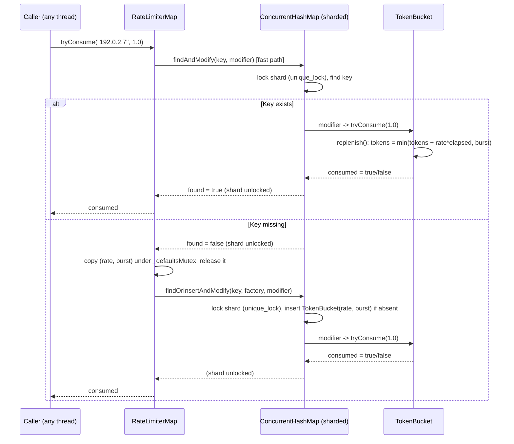

# Iora TokenBucket, SlidingWindowCounter & RateLimiterMap -- Architecture & Programmer's Guide

[Back to index](../../README.md)

| | |
|---|---|
| **Version** | 3.0 |
| **Date** | 2026-10-22 |
| **Status** | IMPLEMENTED |
| **Header** | `include/iora/core/rate_limiter.hpp` |
| **Namespace** | `iora::core` |
| **Public classes** | `TokenBucket`, `SlidingWindowCounter`, `RateLimiterMap<K>` |
| **Dependencies** | Two intra-Iora headers -- `iora/core/concurrent_hash_map.hpp` (`ConcurrentHashMap`, the sharded per-key store) and `iora/core/timing_wheel.hpp` (`TimingWheel`, optional auto-cleanup scheduling). Standard library: `<algorithm>`, `<atomic>`, `<chrono>`, `<cmath>`, `<cstddef>`, `<deque>`, `<functional>`, `<iterator>`, `<memory>`, `<mutex>`, `<optional>`, `<stdexcept>`, `<utility>`, `<vector>`. No external/third-party dependencies. |
| **Architecture doc** | `coding_trackers/architecture/iora/rate_limiter.json` (v1.2.1) |

---

## Revision History

| Version | Date | Changes |
|---|---|---|
| 1.0 | 2026-03-20 | Initial implementation. |
| 1.1 | 2026-03-20 | Fast-path `findAndModify`, atomic defaults, `insertOrAssign` for `setKeyRate`, `_lastAccess` only on success, `TimingWheel` auto-cleanup. |
| 2.0 | 2026-09-10 | **Migrated** into `docs/core/rate_limiter.md` for the iora v1 documentation-wiki (core:primitives CP-2) and re-verified against the header of that date. Restructured to the 12-section guide template. Recorded the then-open defects in section 11. |
| 3.0 | 2026-10-22 | **Re-synced to iora f0b8def** after four fixes: input validation (tracker 2026-09-10-14, iora e1c1bc8), `SlidingWindowCounter` accessor agreement and the `cleanup` pass-2 re-check (2026-09-10-16, d1d2a64), and the auto-cleanup use-after-free fix with its new lifetime contract (2026-09-10-15, f7407fa). Also corrected text that was already stale before these fixes: the defaults are a `(rate, burst)` pair under `_defaultsMutex` (2026-06-04-1), and the `tryConsume` slow path is one `findOrInsertAndModify` call (2026-09-29-2). Documented `getKeyRate`. Removed the fixed defects from Known Limitations. Moved the invariants into section 3.6 and renumbered sections 7-11 to 6-10 (12-section template). |

---

## 1. Executive Summary

### Problem

Iora ships no built-in rate limiting. Without it, every deployment either hardcodes limits, leans on external infrastructure (nginx `limit_req`, iptables `hashlimit`), or re-invents a counter. The demanding case is per-source-IP protection against a SIP `REGISTER` flood: it needs thousands of independent counters keyed by source address, each cheap to look up under contention, with automatic reclamation of idle keys so a flood cannot grow memory without bound. A single global counter cannot express "5 requests per IP per minute"; a `std::map<IP, counter>` behind one mutex serializes every check across every source.

### Solution

Three composable primitives in `iora::core`:

- **`TokenBucket`** -- allows a burst up to a capacity, then enforces a steady refill rate. Lazy (on-demand) replenishment, no background timer, plain `double` arithmetic, no internal locking. Best for API-style limits where a short burst is acceptable.
- **`SlidingWindowCounter`** -- strict "no more than N requests in any T-second window", with **no** burst allowance. Self-contained and internally `std::mutex`-guarded. Best for flood protection where burst is unacceptable.
- **`RateLimiterMap<K>`** -- per-key rate limiting backed by `ConcurrentHashMap<K, TokenBucket>`. Each key (IP, user, trunk) gets its own `TokenBucket`, created on demand at the default rate. Optional idle-bucket eviction driven by a `TimingWheel`.

### Technical Impact

- **Per-key limiting with sharded, near-O(1) lookup.** `ConcurrentHashMap` shards by key hash, so distinct keys rarely contend on the same lock. An existing key costs one shard lock. A new key takes the shard lock twice in sequence (the miss, then create-and-consume), with a brief `_defaultsMutex` hold between them. No two of these locks are held at once.
- **No lock-free complexity in the bucket.** `TokenBucket` is plain `double` state; every mutation inside `RateLimiterMap` runs under the key's shard `unique_lock`. No CAS loops, no ABA, no generation counters.
- **Bad configuration fails at configuration time.** Constructors and `setDefaultRate` reject a non-finite or non-positive rate and a non-finite or negative burst with `std::invalid_argument`, so the per-request path never throws for a bad default.
- **Idle reclamation that is safe to tear down.** `cleanup()` (manual or `TimingWheel`-scheduled) evicts buckets not accessed within `maxIdle`. The auto-cleanup timer never holds `this`, so the map and the wheel may be destroyed in either order.
- **Denied requests do not refresh the idle timer** (`TokenBucket::tryConsume` updates `_lastAccess` only on success), so a source that is continuously rate-limited still ages out and gets reclaimed.

---

## 2. System Architecture

### 2.1 Component relationships

```
iora::core
|-- detail::requireValidTokenBucketParams(rate, burst)   (inline; throws std::invalid_argument)
|
|-- TokenBucket                     (public; non-copyable, movable; plain doubles, NO lock)
|     |-- double _rate              (tokens/second; finite and > 0)
|     |-- double _burstCapacity     (cap and initial balance; finite and >= 0)
|     |-- double _tokens            (current balance)
|     |-- TimePoint _lastRefill     (steady_clock; drives lazy replenish)
|     `-- TimePoint _lastAccess     (steady_clock; updated ONLY on a successful consume)
|
|-- SlidingWindowCounter            (public; standalone; NOT copyable/movable -- holds a mutex)
|     |-- std::size_t _maxRequests  (0 = deny all)
|     |-- std::chrono::seconds _window
|     |-- std::deque<TimePoint> _timestamps   (non-decreasing; never more than _maxRequests entries)
|     `-- mutable std::mutex _mutex
|
`-- RateLimiterMap<K, Hash, KeyEqual>          (public; per-key; NOT copyable/movable)
      |-- std::mutex _defaultsMutex            (leaf lock; guards the default pair)
      |-- double _defaultRate, _defaultBurst   (one (rate, burst) unit)
      `-- std::shared_ptr<State> _state
            `-- State
                  |-- ConcurrentHashMap<K, TokenBucket, Hash, KeyEqual> buckets
                  `-- std::atomic<bool> stopping   (set by ~RateLimiterMap)

Optional collaborator (borrowed, not owned):
  TimingWheel  --one self-re-arming timer per interval--> cleanup pass on State
               (the timer holds only a weak_ptr<State>, never `this`)
```

`RateLimiterMap` owns its [`ConcurrentHashMap`](concurrent_hash_map.md) through the shared `State`. It does **not** own the optional [`TimingWheel`](timing_wheel.md): the wheel is passed by raw pointer and only borrowed, and the map never calls into it after construction except through its own timer callback.

### 2.2 Data flow -- per-key `tryConsume`



The slow path creates and consumes in **one** shard-lock hold, so a concurrent `removeKey` or `cleanup` cannot erase the bucket between its creation and the first consume.

### 2.3 Threading model

| Thread | Responsibility |
|---|---|
| **Any caller thread** | `RateLimiterMap::tryConsume`/`setKeyRate`/`getKeyRate`/`removeKey`/`setDefaultRate`/`cleanup`/`size`, and `SlidingWindowCounter::tryAcquire`/`remaining`/`timeUntilAvailable`. All are safe to call concurrently. |
| **TimingWheel tick thread, its Dispatcher's threads, or the thread calling `drain()`** (optional) | If a `TimingWheel*` was supplied, each timer fire runs one cleanup pass on the shared `State` and re-arms the next fire. The pass runs concurrently with caller operations, synchronized through the `ConcurrentHashMap` shard locks. With no Dispatcher, `drain()` runs due fires on its caller's thread; the re-arm then fails, so that pass is the last. |

A standalone `TokenBucket` used directly (outside a `RateLimiterMap`) has **no** internal synchronization and must be externally serialized by the caller.

---

## 3. Component Deep Dive

### 3.1 Input validation

`detail::requireValidTokenBucketParams(rate, burstCapacity)` is the single rule for bucket parameters. It throws `std::invalid_argument` unless `rate` is finite and `> 0` and `burstCapacity` is finite and `>= 0`. Each check is written in the negated form (`!(std::isfinite(x) && x > 0.0)`), so NaN fails it. It runs:

- as the first statement of the `TokenBucket` constructor body;
- as the first statement of the `RateLimiterMap` constructor body, **before** any cleanup timer is scheduled;
- in `RateLimiterMap::setDefaultRate`, **before** `_defaultsMutex` is taken, so a rejected call changes neither value and holds no lock when it throws.

`setKeyRate` is covered through the `TokenBucket` constructor: its temporary bucket is built before the shard lock is taken, so a bad value throws with no lock held and the map unchanged.

### 3.2 `TokenBucket` -- lazy replenishment, no locking

The bucket holds `_tokens` and lazily tops it up on each access rather than on a timer. `replenish()` (called by `tryConsume`) adds `rate * elapsed` tokens since `_lastRefill`, capped at `_burstCapacity`:

```cpp
void replenish()
{
  auto now = Clock::now();
  auto elapsed = std::chrono::duration<double>(now - _lastRefill).count();
  _tokens = std::min(_tokens + _rate * elapsed, _burstCapacity);
  _lastRefill = now;
}
```

`tryConsume` rejects a negative or NaN request before it touches any state, then replenishes and consumes only if the balance suffices:

```cpp
bool tryConsume(double tokens = 1.0)
{
  if (!(tokens >= 0.0))
  {
    return false;              // no state is changed
  }
  replenish();
  if (_tokens >= tokens)
  {
    _tokens -= tokens;
    _lastAccess = Clock::now();  // updated ONLY on success
    return true;
  }
  return false;
}
```

Key properties:

- **Clock.** `Clock = std::chrono::steady_clock` -- monotonic, immune to wall-clock jumps.
- **Initial fill.** The constructor sets `_tokens = burstCapacity`, so a fresh bucket starts full.
- **No minting, no underflow.** A negative or NaN `tokens` is rejected; `_tokens -= tokens` runs only inside `if (_tokens >= tokens)`. The balance stays in `[0, _burstCapacity]`.
- **`availableTokens() const`** is a pure read: `min(_tokens + _rate * elapsed, _burstCapacity)` against `_lastRefill`, without mutating anything.
- **`timeUntilAvailable(tokens = 1.0) const`** returns:
  - `std::chrono::milliseconds::max()` if the request can never succeed: `tokens` is negative or NaN, or `tokens > _burstCapacity` (the balance is clamped to the burst);
  - `0ms` if the tokens are available now;
  - otherwise `ceil((tokens - available) / _rate * 1000)` milliseconds, or `milliseconds::max()` if that value does not fit (for example a very small rate). The value is compared against `max().count()` as a `double` **before** the cast, so the out-of-range float-to-integer conversion that used to be undefined behavior cannot happen.
  - Callers must check for `milliseconds::max()` before adding the result to a `time_point` or using it as a `Retry-After` value (architecture designPrinciples[9], human decision HD-CP-1).
- **`_lastAccess` on success only.** A denied request does not refresh the idle timer, so a continuously denied source still ages out.
- **Copy/move.** Copy is deleted; move is defaulted. Deleting copy prevents "mutate a copy, lose the write"; move lets a freshly built bucket be inserted into the map.

### 3.3 `SlidingWindowCounter` -- strict window, internally locked

Enforces "at most `_maxRequests` in any trailing `_window`" with no burst credit. Storage is a `std::deque<TimePoint>`; each successful `tryAcquire` appends `now`. The deque is non-decreasing (every `now` is read and pushed under `_mutex`), so the expired entries are always a prefix.

One private helper owns the expiry rule:

```cpp
std::deque<TimePoint>::const_iterator firstActive(TimePoint now) const
{
  return std::find_if(_timestamps.cbegin(), _timestamps.cend(),
                      [&](TimePoint ts) { return now - ts < _window; });
}
```

- **`tryAcquire()`** erases the expired prefix (`[begin, firstActive(now))`), returns `false` if the remaining size is `>= _maxRequests`, else appends `now` and returns `true`. Because it evicts first and appends only below the limit, the deque never holds more than `_maxRequests` entries -- memory is bounded.
- **`remaining() const`** returns `_maxRequests - active` (floored at 0), where `active` is the distance from `firstActive(now)` to the end. It does not evict.
- **`timeUntilAvailable() const`** does not evict either. It returns:
  - the window length (`duration_cast<milliseconds>(_window)`) when `_maxRequests == 0` -- a deny-all counter has no slot that will ever open, and a bounded back-off is safer for callers than `milliseconds::max()` (iora_sip adds 999ms to this value before its own clamp);
  - `0ms` when the active count is below `_maxRequests`;
  - otherwise the time until the oldest active entry expires, plus 1ms (round-up).
- **Agreement.** All three methods use the same active count, so after a partial rollover `remaining()`, `timeUntilAvailable()` and `tryAcquire()` agree.
- **Thread safety.** One `mutable std::mutex _mutex` guards every method, including the `const` accessors. Because it holds a mutex, the counter is **neither copyable nor movable**.

### 3.4 `RateLimiterMap<K>` -- per-key buckets

Template over the key type plus `Hash`/`KeyEqual` (defaulting to `std::hash<K>` / `std::equal_to<K>`). Copy and move are explicitly deleted.

**State layout.** The buckets and a `stopping` flag live in a private `State` held by `std::shared_ptr`. The defaults `(rate, burst)` and their `_defaultsMutex` stay in the map object itself; the cleanup timer never reads them.

**`tryConsume` (fast path).** `findAndModify(key, modifier)` takes the key's shard `unique_lock` and, if the key exists, runs `bucket.tryConsume(tokens)` in place. One lock, no bucket constructed.

**`tryConsume` (slow path).** If the key is absent, copy the default pair under `_defaultsMutex` and release it, then call `findOrInsertAndModify(key, factory, modifier)`. Under **one** shard `unique_lock` it inserts `TokenBucket(rate, burst)` if the key is still absent and runs the consume. `_defaultsMutex` is never held together with a shard lock.

**`setDefaultRate(rate, burst)`.** Validates both values first, then assigns the pair under `_defaultsMutex`. Affects only buckets created afterward; a concurrent creator never sees a torn `(new rate, old burst)` pair.

**`setKeyRate(key, rate, burst)`.** `insertOrAssign(key, TokenBucket(rate, burst))` -- one shard `unique_lock`, atomic replace. This **resets** the key's bucket to a full burst at the new parameters. Throws `std::invalid_argument` for a bad value (the bucket is unchanged).

**`getKeyRate(key) const`.** Returns the key's `(rate, burst)` as `std::optional<std::pair<double, double>>`, or `std::nullopt` if the key has no bucket. Shared-lock read.

**`removeKey(key)`.** `erase(key)` -- one shard `unique_lock`, unconditional.

**`cleanup(maxIdle)`.** Two passes, because `forEach` holds a **shared** lock and cannot erase. One local predicate owns the idle rule for both passes:

```cpp
auto now = Clock::now();
auto maxIdleMs = std::chrono::duration_cast<std::chrono::milliseconds>(maxIdle);
auto isIdle = [&](const TokenBucket& bucket)
{
  return std::chrono::duration_cast<std::chrono::milliseconds>(now - bucket.lastAccess()) >
         maxIdleMs;
};
// Pass 1: collect idle keys (forEach, shared_lock per shard)
// Pass 2: for each key, eraseIf(key, isIdle) -- find, re-check and erase under one unique_lock
```

Pass 2 re-checks idleness under the erase lock, against pass 1's `now`. A key refreshed by a successful `tryConsume`, or removed and re-created, between the passes gets a `lastAccess` stamped under the shard lock after pass 1's `now`, so it is kept. A key replaced by `setKeyRate` between the passes carries the `lastAccess` of its new bucket, which is built before the shard lock is taken. It is kept unless that build happened more than `maxIdle` before pass 1's `now` (possible only with a very small `maxIdle`). Only a bucket that is still idle at erase time is evicted.

### 3.5 Auto-cleanup

If a `TimingWheel*` is passed to the constructor, the constructor's last action is to arm one cleanup timer:

```cpp
static TimerId armCleanup(TimingWheel& wheel, std::weak_ptr<State> weak,
                          std::chrono::milliseconds interval, std::chrono::seconds maxIdle)
{
  return wheel.schedule(interval,
                        [&wheel, weak, interval, maxIdle]()
                        {
                          auto s = weak.lock();
                          if (!s || s->stopping.load(std::memory_order_acquire))
                          {
                            return;
                          }
                          armCleanup(wheel, weak, interval, maxIdle);
                          cleanupState(*s, maxIdle);
                        });
}
```

- **The timer never holds `this`.** It captures only a `weak_ptr<State>`. A pending, collected or dispatched fire after the map is gone finds `lock()` empty, or, while an earlier pass still runs, finds `stopping` set. Either way it does nothing.
- **A running pass keeps the state alive.** The fire's local `shared_ptr` keeps the buckets and their shard mutexes alive until the pass returns. The state is destroyed on whichever thread drops the last reference.
- **`stopping` ends the chain.** On a multi-thread Dispatcher a fire can overlap a running pass and `lock()` the state through that pass's reference after the map is destroyed; the `stopping` flag set by the destructor stops it from re-arming. The `weak_ptr` is the memory-safety mechanism; `stopping` is the termination guard.
- **Re-arm before the pass.** One pass starts per `cleanupInterval`, and a pass that throws cannot end the chain.
- **The wheel must be RUNNING.** If the first `schedule` returns `InvalidTimerId`, the constructor throws `std::runtime_error` and nothing is scheduled. A later re-arm that returns `InvalidTimerId` (wheel stopped, draining or reset) ends the chain. A Dispatcher that discards a fired callback instead of running it also ends the chain, because the re-arm runs inside that callback.
- **The destructor never blocks and never calls into the wheel.** It sets `stopping` and releases its reference.

### 3.6 Invariants

- **`TokenBucket` balance invariant.** `0 <= _tokens <= _burstCapacity` always holds: parameters are validated, negative/NaN requests are rejected, the `min(...)` clamps the top, and the `if (_tokens >= tokens)` guard protects the bottom.
- **`_lastRefill` monotonicity.** `replenish()` always advances `_lastRefill` to `now`; `availableTokens()`/`timeUntilAvailable()` never write it.
- **`SlidingWindowCounter` deque.** Non-decreasing and at most `_maxRequests` long; the expired entries are always a prefix found by `firstActive`.
- **`RateLimiterMap` size.** `size()` sums the shard sizes, taking each shard's `shared_lock` in turn. Under concurrent changes the result is approximate: it need not match the map at any single moment.
- **Auto-cleanup chain.** At most one wheel entry is armed per map at any time: each fire re-arms at most one. An entry is briefly unarmed between its collection and its re-arm. None is armed once the chain has ended, or for a map built without a wheel. After the map is destroyed, at most one already-armed entry stays pending until it fires once and does nothing, or the wheel discards it.

---

## 4. Usage Guide

### 4.1 Per-key API rate limiting

```cpp
#include "iora/core/rate_limiter.hpp"
#include <string>

using namespace iora::core;

// 100 tokens/sec steady, burst up to 50, per client key.
RateLimiterMap<std::string> limiter(100.0, 50.0);

bool admit(const std::string& clientIp)
{
  return limiter.tryConsume(clientIp);   // auto-creates a full bucket on first sight
}
```

`RateLimiterMap` exposes no per-key `timeUntilAvailable`, so it cannot itself produce an exact `Retry-After`. Do **not** call `tryConsume` a second time to "peek" -- that consumes another token. Use a fixed back-off, or hold a `TokenBucket`/`SlidingWindowCounter` directly.

### 4.2 A standalone `TokenBucket` (single caller serializes)

```cpp
#include "iora/core/rate_limiter.hpp"
#include <chrono>

using namespace iora::core;

void standaloneBucket()
{
  TokenBucket bucket(10.0, 10.0);          // 10/sec, burst 10, starts full

  if (!bucket.tryConsume(1.0))
  {
    auto wait = bucket.timeUntilAvailable(1.0);
    if (wait != std::chrono::milliseconds::max())
    {
      // schedule a retry after `wait`
    }
    else
    {
      // the request can never succeed with this bucket; reject it
    }
  }
}
```

### 4.3 Strict SIP `REGISTER` flood protection (no burst)

```cpp
#include "iora/core/rate_limiter.hpp"
#include <chrono>

using namespace iora::core;

// One counter per source: at most 5 REGISTERs per 60s, no burst credit.
//   SlidingWindowCounter counter(5, std::chrono::seconds(60));
// Returns true to process the REGISTER. On false, retryAfter is a bounded
// wait (never milliseconds::max()) for a 503 Retry-After.
bool admitRegister(SlidingWindowCounter& counter, std::chrono::milliseconds& retryAfter)
{
  if (!counter.tryAcquire())
  {
    retryAfter = counter.timeUntilAvailable();
    return false;
  }
  return true;
}
```

### 4.4 Per-key limiting with `TimingWheel` auto-cleanup

See [timing_wheel.md](timing_wheel.md) for `TimingWheel` construction and scheduling semantics.

```cpp
#include "iora/core/rate_limiter.hpp"
#include "iora/core/timing_wheel.hpp"
#include <chrono>
#include <string>

using namespace iora::core;

void serveWithAutoCleanup()
{
  TimingWheel wheel(std::chrono::milliseconds(100), 64, 3);   // tick=100ms, 64 ticks, 3 wheels
  wheel.start();                                              // must be RUNNING before the map

  // One cleanup pass every 60s; evict buckets idle for more than 300s.
  RateLimiterMap<std::string> limiter(100.0, 50.0, &wheel,
                                      std::chrono::seconds(60),
                                      std::chrono::seconds(300));

  // ... serve traffic; limiter.tryConsume(ip) per request ...

  // Teardown: the wheel and the limiter may be destroyed in either order.
}
```

If the wheel is not running, the constructor throws `std::runtime_error`. If the wheel is stopped later, auto-cleanup ends; call `cleanup()` yourself or build a new map.

### 4.5 Per-key overrides

```cpp
#include "iora/core/rate_limiter.hpp"
#include <string>

using namespace iora::core;

void configureOverrides()
{
  RateLimiterMap<std::string> limiter(10.0, 10.0);   // default 10/sec, burst 10

  limiter.setKeyRate("trusted-trunk", 1000.0, 500.0);  // this key: 1000/sec, burst 500 (reset full)
  limiter.setDefaultRate(20.0, 20.0);                  // future NEW keys: 20/sec, burst 20
                                                       // (existing keys unaffected)
  auto r = limiter.getKeyRate("trusted-trunk");        // std::optional<std::pair<double, double>>
}
```

### 4.6 Anti-patterns

- **Do NOT call `RateLimiterMap::tryConsume` twice to compute a wait/`Retry-After`.** The second call consumes another token.
- **Do NOT use `TokenBucket::timeUntilAvailable` without checking for `milliseconds::max()`.** Adding it to a `time_point` or to another duration overflows.
- **Do NOT pass a stopped or not-yet-started `TimingWheel`.** The constructor throws `std::runtime_error`.
- **Do NOT expect a restarted wheel to resume auto-cleanup.** Stopping, draining or resetting the wheel ends it.
- **Do NOT destroy a wheel that has a Dispatcher before draining the dispatcher.** A dispatched pass for a live map re-arms through `wheel.schedule` (TimingWheel's own rule).
- **Do NOT call `setDefaultRate` expecting existing buckets to change.** Use `setKeyRate` for a live key.
- **Do NOT store a `SlidingWindowCounter` by value in a container that copies or moves it.** Hold it via `std::unique_ptr` if you must.
- **Do NOT call other `RateLimiterMap` methods concurrently with its destructor** (the standard object rule).

---

## 5. Call Flow / Sequence Reference

### 5.1 `RateLimiterMap::tryConsume` -- existing key (fast path)

| Step | Actor | Action | Lock state |
|---|---|---|---|
| 1 | Caller | `tryConsume(key, tokens)`; `consumed = false`. | no lock |
| 2 | `findAndModify` | Hash the key, acquire the shard `unique_lock`, find the key. | shard `unique_lock` held |
| 3 | modifier | `consumed = bucket.tryConsume(tokens)`. | shard `unique_lock` held |
| 4 | `findAndModify` | Return `true`; release the shard lock. | released |
| 5 | Caller | Return `consumed`. | no lock |

### 5.2 `RateLimiterMap::tryConsume` -- new key (slow path)

| Step | Actor | Action | Lock state |
|---|---|---|---|
| 1 | `findAndModify` | Miss -> `found = false`. | shard lock taken then released |
| 2 | Defaults | Copy `(rate, burst)` under `_defaultsMutex`; release it. | `_defaultsMutex` only |
| 3 | `findOrInsertAndModify` | Acquire the shard `unique_lock`; insert `TokenBucket(rate, burst)` if still absent; run `consumed = bucket.tryConsume(tokens)`. | one shard `unique_lock` |
| 4 | Caller | Return `consumed`. | no lock |

A rejected first request on a new key (negative tokens, or more tokens than the burst) still inserts a full bucket; `cleanup` removes it after `maxIdle`.

### 5.3 `SlidingWindowCounter::tryAcquire`

| Step | Actor | Action | Lock state |
|---|---|---|---|
| 1 | Caller | Acquire `_mutex`; read `now`. | `_mutex` held |
| 2 | `evictExpired` | Erase `[begin, firstActive(now))`. | `_mutex` held |
| 3 | Guard | If `size() >= _maxRequests` -> return `false`. | `_mutex` released on return |
| 4 | Admit | `push_back(now)`; return `true`. | `_mutex` released |

### 5.4 `RateLimiterMap::cleanup` (two-pass eviction)

| Step | Actor | Action | Lock state |
|---|---|---|---|
| 1 | `cleanup` | Read `now`; build the `isIdle` predicate. | no lock |
| 2 | `forEach` | Per shard: `shared_lock`, collect keys with `isIdle(bucket)`. | one shard `shared_lock` at a time |
| 3 | Gap | Nothing held between the passes. | no lock |
| 4 | `eraseIf` loop | Per collected key: find, re-check `isIdle`, erase if still idle. | one shard `unique_lock` per key |

### 5.5 Auto-cleanup fire

| Step | Actor | Action | Lock state |
|---|---|---|---|
| 1 | Wheel | Fire the callback (tick thread, a Dispatcher thread, or, with no Dispatcher, the thread calling `drain()`). | no wheel lock held |
| 2 | Callback | `weak.lock()`; return if empty or `stopping`. | none |
| 3 | Callback | `armCleanup(...)` -- schedule the next fire. | wheel locks inside `schedule`, released |
| 4 | Callback | `cleanupState(*s, maxIdle)` -- the two-pass cleanup above. | shard locks as in 5.4 |
| 5 | Callback | Drop the local `shared_ptr`; if it was the last reference, `State` is destroyed here. | none |

---

## 6. Thread Safety Model

| Operation | Synchronization | Notes |
|---|---|---|
| `TokenBucket` methods | **None internally.** | Via `RateLimiterMap`, every mutation runs under the key's shard `unique_lock`. A standalone bucket must be serialized by the caller. |
| `SlidingWindowCounter` methods | `std::lock_guard<std::mutex>` on `_mutex`. | Fully self-synchronizing; the `const` accessors do not mutate. |
| `RateLimiterMap::tryConsume` | Existing key: one shard `unique_lock` (`findAndModify`). New key: that shard lock (miss, released), then `_defaultsMutex` (copy the defaults, released), then one shard `unique_lock` (`findOrInsertAndModify`). Never two locks at once. | Create-and-consume is atomic for a new key. |
| `RateLimiterMap::setDefaultRate` | Validation, then `_defaultsMutex`. | The pair is published as one unit. |
| `RateLimiterMap::setKeyRate` | `insertOrAssign` -- one shard `unique_lock`. | Atomic replace; resets the bucket to full burst. |
| `RateLimiterMap::getKeyRate` | One shard `shared_lock` (`findAndDo`). | Consistent read of one key. |
| `RateLimiterMap::size` | Each shard's `shared_lock`, one at a time. | Approximate under concurrent changes. |
| `RateLimiterMap::removeKey` | `erase` -- one shard `unique_lock`. | Unconditional. |
| `RateLimiterMap::cleanup` | Pass 1 `forEach` (per-shard `shared_lock`); pass 2 `eraseIf` (per-key `unique_lock`). | Nothing held between passes; pass 2 re-checks idleness under the erase lock. |
| Auto-cleanup fire | `weak_ptr<State>::lock()`, `stopping` (acquire/release), then the cleanup locks. | No wheel lock is held during the pass. |
| `~RateLimiterMap` | `stopping.store(true, release)`. | Never blocks; never calls the wheel. |

**Lock inventory.**

- `SlidingWindowCounter::_mutex` -- the counter's only lock.
- [`ConcurrentHashMap`](concurrent_hash_map.md)'s per-shard `std::shared_mutex` -- reached by every bucket operation.
- `RateLimiterMap::_defaultsMutex` -- a **leaf** lock: never held while a shard lock is taken, and never taken while a shard lock is held.

**Callbacks under lock.** The `cleanup` predicates (`forEach` in pass 1, `eraseIf` in pass 2) run under a shard lock. They only read `bucket.lastAccess()` and push to a local vector; they never re-enter the map or take another lock.

**Lock ordering.** No operation holds two of these locks at once, so there is no lock-ordering hazard. The auto-cleanup fire takes the wheel's locks inside `schedule` and releases them before the pass takes any shard lock.

**Auto-cleanup lifetime contract.**

1. The `TimingWheel` and the `RateLimiterMap` may be stopped or destroyed in either order. `~RateLimiterMap` never calls into the wheel and never blocks.
2. The cleanup wheel must be RUNNING when the map is constructed; otherwise the constructor throws `std::runtime_error` and nothing is scheduled. Stopping, draining or resetting the wheel later ends auto-cleanup. Do not rely on a restart to re-arm it: build a new map, or call `cleanup()` yourself. A Dispatcher that discards a fired callback also ends auto-cleanup.
3. After `~RateLimiterMap` returns, every cleanup pass that had already started may still finish. With no Dispatcher or a single-thread one, that is at most one pass. With a multi-thread Dispatcher, passes longer than `cleanupInterval` may overlap, so more than one may finish. The internal state (the `K`, `TokenBucket`, `Hash` and `KeyEqual` destructors) is destroyed on the thread that drops the last reference: the destructor's own thread, or a thread that runs timer fires (section 2.3) and was running a pass or a fire's guard check. At most one already-armed wheel entry stays pending until it fires once and does nothing, or the wheel discards it.
4. If the wheel has a Dispatcher, drain the dispatcher before destroying the wheel (TimingWheel's own rule).
5. Public `RateLimiterMap` methods must not be called concurrently with `~RateLimiterMap`.
6. While the chain runs (point 2), auto-cleanup starts one `cleanup(maxIdle)` pass per `cleanupInterval`.

---

## 7. Configuration Reference

### 7.1 `TokenBucket`

| Parameter | Type | Default | Units | Notes |
|---|---|---|---|---|
| `rate` | `double` | (required) | tokens/second | Must be finite and `> 0`; otherwise the constructor throws `std::invalid_argument`. |
| `burstCapacity` | `double` | (required) | tokens | Maximum and initial balance. Must be finite and `>= 0`; otherwise `std::invalid_argument`. |

### 7.2 `SlidingWindowCounter`

| Parameter | Type | Default | Units | Notes |
|---|---|---|---|---|
| `maxRequests` | `std::size_t` | (required) | count | Max acquires per window. `0` means deny all; `timeUntilAvailable()` then returns the window length. |
| `window` | `std::chrono::seconds` | (required) | seconds | Trailing window length. Second granularity only. |

### 7.3 `RateLimiterMap<K>`

| Parameter | Type | Default | Units | Notes |
|---|---|---|---|---|
| `defaultRate` | `double` | (required) | tokens/second | Rate for auto-created buckets. Validated like `TokenBucket::rate`. |
| `defaultBurst` | `double` | (required) | tokens | Burst for auto-created buckets. Validated like `TokenBucket::burstCapacity`. |
| `cleanupWheel` | `TimingWheel*` | `nullptr` | -- | If non-null, must be RUNNING (else `std::runtime_error`); arms the auto-cleanup timer. |
| `cleanupInterval` | `std::chrono::seconds` | `60` | seconds | One cleanup pass per interval (ignored when `cleanupWheel == nullptr`). Not validated: `<= 0` means a pass on every wheel tick. |
| `maxIdle` | `std::chrono::seconds` | `300` | seconds | Idle threshold used by **auto-cleanup**. The manual `cleanup(maxIdle)` takes its own argument. Not validated; use `>= 0` (section 10). |

---

## 8. API Reference

```cpp
namespace iora
{
namespace core
{

namespace detail
{
// Throws std::invalid_argument unless rate is finite and > 0 and
// burstCapacity is finite and >= 0.
inline void requireValidTokenBucketParams(double rate, double burstCapacity);
} // namespace detail

class TokenBucket
{
public:
  using Clock = std::chrono::steady_clock;
  using TimePoint = Clock::time_point;

  TokenBucket(double rate, double burstCapacity);   // throws std::invalid_argument

  TokenBucket(const TokenBucket&) = delete;
  TokenBucket& operator=(const TokenBucket&) = delete;
  TokenBucket(TokenBucket&&) = default;
  TokenBucket& operator=(TokenBucket&&) = default;

  bool tryConsume(double tokens = 1.0);              // false for negative/NaN, no state change
  double availableTokens() const;
  std::chrono::milliseconds timeUntilAvailable(double tokens = 1.0) const;  // may return max()
  TimePoint lastAccess() const;
  double rate() const;
  double burstCapacity() const;
};

class SlidingWindowCounter
{
public:
  using Clock = std::chrono::steady_clock;
  using TimePoint = Clock::time_point;

  SlidingWindowCounter(std::size_t maxRequests, std::chrono::seconds window);
  // Non-copyable and non-movable (holds a std::mutex).

  bool tryAcquire();
  std::size_t remaining() const;
  std::chrono::milliseconds timeUntilAvailable() const;   // window length when maxRequests == 0
};

template <typename K, typename Hash = std::hash<K>,
          typename KeyEqual = std::equal_to<K>>
class RateLimiterMap
{
public:
  using Clock = std::chrono::steady_clock;

  // throws std::invalid_argument (bad defaults) or std::runtime_error (wheel not running)
  RateLimiterMap(double defaultRate, double defaultBurst,
                 TimingWheel* cleanupWheel = nullptr,
                 std::chrono::seconds cleanupInterval = std::chrono::seconds(60),
                 std::chrono::seconds maxIdle = std::chrono::seconds(300));
  ~RateLimiterMap();   // non-blocking; never calls the wheel

  RateLimiterMap(const RateLimiterMap&) = delete;
  RateLimiterMap& operator=(const RateLimiterMap&) = delete;
  RateLimiterMap(RateLimiterMap&&) = delete;
  RateLimiterMap& operator=(RateLimiterMap&&) = delete;

  bool tryConsume(const K& key, double tokens = 1.0);
  void setDefaultRate(double rate, double burst);                    // throws std::invalid_argument
  void setKeyRate(const K& key, double rate, double burst);          // throws std::invalid_argument
  std::optional<std::pair<double, double>> getKeyRate(const K& key) const;
  void removeKey(const K& key);
  void cleanup(std::chrono::seconds maxIdle);
  std::size_t size() const;
};

} // namespace core
} // namespace iora
```

---

## 9. Design Decisions

| ID | Decision | Rationale |
|---|---|---|
| D-1 | Lazy replenishment in `TokenBucket` (no background timer). | Refilling on access needs no thread and no per-bucket timer. |
| D-2 | Plain `double` state, no atomics/CAS in `TokenBucket`. | Inside `RateLimiterMap` every mutation runs under a shard `unique_lock`, so lock-free machinery would add complexity for no benefit. |
| D-3 | `TokenBucket` non-copyable, movable. | "Mutate a copy, lose the write" becomes a compile error; movability lets a new bucket be inserted. |
| D-4 | `_lastAccess` refreshed only on a successful `tryConsume`. | A continuously denied flood source still ages out. |
| D-5 | `SlidingWindowCounter` for strict enforcement, separate from `TokenBucket`. | Some flows (SIP `REGISTER`) cannot tolerate any burst. |
| D-6 | `ConcurrentHashMap` (sharded) as the per-key store. | Distinct keys proceed without contending on one lock. |
| D-7 | Fast-path `findAndModify`, slow path `findOrInsertAndModify`. | The common case is one lock with no throwaway bucket; a new key is created and consumed in one lock hold, closing the erase-between-steps window. |
| D-8 | `insertOrAssign` for `setKeyRate`. | Single-lock atomic replace; `erase`+`insert` would expose a TOCTOU window. |
| D-9 | Default `(rate, burst)` as one pair under a leaf `_defaultsMutex`. | Two independent atomics allowed a torn pair; the mutex is never nested with a shard lock. |
| D-10 | Two-pass `cleanup` with one `isIdle` predicate and an `eraseIf` re-check. | `forEach` cannot erase; re-checking under the erase lock keeps buckets that became active between the passes. |
| D-11 | Optional `TimingWheel` auto-cleanup through a `weak_ptr<State>` guard (the `iora::util::TtlMap` pattern) instead of capturing `this`. | Reuses the shared timing infrastructure without an owned thread, and makes both teardown orders safe. `wheel.cancel` in the destructor was rejected: it cannot stop a collected or running callback and would need a live wheel. |
| D-12 | Validate parameters at configuration time; `tryConsume` returns `false` for bad requests instead of throwing. | A bad default fails once at construction instead of on every request under a shard lock; the per-request contract stays "returns false if not admitted". |
| D-13 | `TokenBucket::timeUntilAvailable` returns `milliseconds::max()` for a request that can never succeed; `SlidingWindowCounter` returns the window length for a deny-all counter. | A finite value for a never-satisfiable bucket request would be a false retry hint (human decision HD-CP-1); the deny-all counter keeps a bounded value because iora_sip adds to it before clamping. |

---

## 10. Known Limitations

- **`RateLimiterMap` offers no non-consuming per-key wait query.** There is no per-key `availableTokens`/`timeUntilAvailable` (only `getKeyRate`). Callers cannot compute an exact `Retry-After` without holding the bucket directly.
- **`TokenBucket::timeUntilAvailable` can return `std::chrono::milliseconds::max()`.** Callers must check for it before arithmetic (design decision D-13).
- **A rejected first request on a new key still creates a full bucket.** A negative-token or over-burst request on an absent key inserts the bucket before the consume is rejected; `cleanup` removes it after `maxIdle`.
- **`cleanupInterval` and `maxIdle` are not validated.** An interval `<= 0` runs a full cleanup pass on every wheel tick. A negative `maxIdle` makes every bucket count as idle, including one refreshed between the two passes, so the pass-2 re-check no longer protects it. Both are operator settings; use `maxIdle >= 0`.
- **Overlapping cleanup passes on a multi-thread Dispatcher.** Because the timer re-arms before the pass, a pass that runs longer than `cleanupInterval` can overlap the next one. Overlapping passes are safe (they use only `ConcurrentHashMap` operations), but more than one may still finish after the destructor (lifetime contract point 3).
- **`SlidingWindowCounter` is neither copyable nor movable.** Hold it behind a `std::unique_ptr` for per-key window limiting.
- **`window` is limited to `std::chrono::seconds` granularity.** Sub-second sliding windows are not expressible.

### Test coverage cross-check

`tests/core/iora_test_rate_limiter.cpp` (46 test cases) covers the happy paths of all three classes and the fixed defects: parameter validation and NaN/infinity handling, negative-token rejection, the `timeUntilAvailable` sentinel and overflow saturation, validation order versus scheduling and versus the default pair, `SlidingWindowCounter` partial rollover and deny-all, `cleanup` keeping a key refreshed or replaced between the passes (a test-local hash hook places the call between the passes), threshold eviction, and the auto-cleanup lifetime (map destroyed while the entry is pending, after collection, during a running pass, an overlapping fire, wheel destroyed first, re-emplacement at the same address, one pass per fire, and a not-running wheel). The target is in `IORA_SANITIZED_TEST_TARGETS`, and the lifetime rows are ASan- and TSan-clean.
