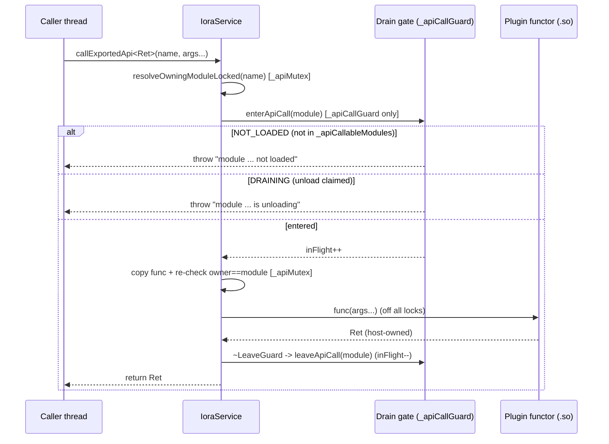

# Iora Service (`iora::IoraService`) — Architecture & Programmer's Guide

[Back to index](../README.md)

| | |
|---|---|
| **Version** | 1.9 |
| **Date** | 2026-10-17 |
| **Status** | IMPLEMENTED |
| **Header** | `include/iora/iora.hpp` |
| **Namespace** | `iora` (`iora::IoraService`, `iora::IoraPlugin`) |
| **Dependencies** | `core/callback_ownership.hpp`, `core/config_loader.hpp`, `core/metrics.hpp`, `core/event_queue.hpp`, `core/logger.hpp`, `core/plugin_loader.hpp`, `core/service_registry.hpp`, `core/thread_pool.hpp`, `network/http_client.hpp`, `network/webhook_server.hpp`, `parsers/json.hpp`, `parsers/xml.hpp`, `storage/concrete_state_store.hpp`, `storage/json_file_store.hpp`, `system/shell_runner.hpp`, `util/expiring_cache.hpp`, `util/filesystem.hpp` |

## Revision History

| Version | Date | Changes |
|---------|------|---------|
| 1.0 | 2026-09-09 | Initial flagship guide for the framework entry point. Documents the `IoraService` singleton lifecycle, the nested `Config` structure, the `Plugin` model and `IORA_DECLARE_PLUGIN`, the exported-API access surface (`exportApi`, `getExportedApi`, `getExportedApiSafe`/`SafeApiFunction`, `callExportedApi`), the `RouteBuilder`/`EventBuilder` fluent DSL, and — in depth — the concurrency model that makes module unload use-after-free-safe (the drain gate, the clear-before-dlclose machinery, the host-only wrapper rule, and the documented lock ordering). Traced directly against `include/iora/iora.hpp`. |
| 1.1 | 2026-09-24 | DOC-4: rehomed content from the removed README sections and corrected claims against source. §1 and §9 no longer call the `SafeApiFunction` fast path zero-cost (each call takes `_loadModulesMutex` briefly and holds `cacheMutex` across the invoke). §3.2 states the silent-plaintext TLS consequence; §3.3 documents when dependency hooks fire (including that a batch unload does not notify) and that their exceptions are swallowed; §3.4 adds the relative cost of the access paths and what the tests assert; §3.5/§3.6 list the `std::runtime_error`s each path throws, the per-wrapper serialization, and the refresh-path exception wrapping; new §5.5 (batch `loadModules` failure handling); the §4.1 `catch` comment no longer implies `shutdown()` cleans up after a failed `init()`; §7 separates the `Config` struct from the `iora` executable's TOML keys and lists the fields no file key reaches; Known Limitations adds the related defects. |
| 1.2 | 2026-09-24 | DOC-4 doc-review fixes: the `DP-7` self-unload guard is limited to `callExportedApi` (§1, §4.5, §9); unloading a module from inside a call through one of its `SafeApiFunction` wrappers self-deadlocks (new Known Limitation). §6 lock ordering adds `cacheMutex` → every lock the exported function can reach, and Known Limitations adds two cross-thread deadlocks that follow from it; `TS-1` no longer claims no lock is held across the wait. §3.3 extends the must-not-call rule from the dependency hooks to `onLoad`/`onUnload` and completes the list. §1, §3.4 and §3.6 state that each `SafeApiFunction`/`callExportedApi` call waits for any concurrent load or unload (including user `onLoad`/`onUnload`/hook code), and §3.4 adds the per-call debug-message string. §3.3 corrects the state of M when `onDependencyUnloaded` runs. §3.5 documents that `Args` must be given explicitly and that by-value parameter types then need rvalue arguments. §3.2/§7/Known Limitations cover every missing cert/key/CA case, including a requested mTLS setup, and say the indication is INFO-only. §3.6 and Known Limitations limit the slow-path rewrap to `std::exception`-derived throws. §5.1/§5.5: `validateModulePath` applies only to `loadSingleModule(const std::string&)`, and a new row covers a throwing custom factory or a non-`std` throw from an `IORA_DECLARE_PLUGIN` constructor. Known Limitations: load order can be controlled by a host with `modules.autoLoad=false` plus `loadSingleModule` calls; a webhook `start()` failure leaves the server never started and the retry's `shutdown()` returns early; the installed template path differs from the executable's default config path. Known Limitation rows cite their coding_trackers backlog trackers. |
| 1.3 | 2026-10-01 | TLS fail-closed fix (tracker 2026-09-24-11): `applyConfig` no longer gates TLS on all of cert+key+CA. §3.2, §7 config table, and Known Limitations rewritten — TLS is now enabled when `certFile`+`keyFile` are set (empty string = unset); `caFile` is required only for mTLS (enforced by `HttpServer::enableTls`); any **partially** configured TLS (one of cert/key, `caFile`/`requireClientCert` without cert+key, mTLS without CA) now **aborts `init()` with a thrown `std::runtime_error`** and an ERROR log naming the fields, instead of silently serving plaintext — there is no longer a silent-plaintext downgrade. A `requireClientCert=true` listener comes up as server-auth-only TLS and logs a WARN that client-certificate **enforcement** is not yet active (owned by tracker 2026-09-12-8); the old silent-plaintext Known Limitation is replaced by this enforcement-pending note. |
| 1.4 | 2026-10-16 | mTLS enforcement is now active (tracker 2026-09-12-8). A `requireClientCert = true` listener requires and verifies a client certificate that chains to `caFile`; a client with no certificate or an untrusted one is rejected in the TLS handshake. The `applyConfig` WARN that said enforcement was not yet active is removed. §3.2, the §7 `tls.requireClientCert` row, and Known Limitations updated; the enforcement-pending Known Limitation is removed. |
| 1.5 | 2026-10-16 | Install/config path (tracker 2026-09-24-12): the `iora` executable's default config file is now the installed `iora.cfg` (configure-time `<prefix>/etc/iora.conf.d/iora.cfg`, or an absolute `CMAKE_INSTALL_SYSCONFDIR`), and it sets `Config::configFile` to it; the library default `IORA_DEFAULT_CONFIG_FILE_PATH` is unchanged. §7 and the `configFile` row updated; the "template not installed where the executable looks" Known Limitation is replaced by the configure-time relocation limitation. |
| 1.6 | 2026-10-16 | Config keys and batch load (tracker 2026-09-24-16). `loadModules()` now logs and skips a module that fails to load (std and non-std exceptions) and continues the batch; §3 step 9, §5.5 and Known Limitations rewritten, and a plugin-author precondition (onUnload is not called on a failed load) added to §4.5 and Known Limitations. The `iora` executable now reads `iora.modules.modules` and `iora.log.compressAfterDays` (§7 tables). The shipped `iora.cfg` template uses the keys the executable reads, keeps TLS, the module list and `[iora.features]` as `#? ` optional lines, and gets its paths from the install-time prefix; the "template largely ignored" Known Limitation is removed and an upgrade note is added. `Plugin::require()`'s error names the load-order key. Known Limitation citations repointed after the tracker split. |
| 1.7 | 2026-10-17 | Plugin callback ownership (tracker 2026-10-16-12). Webhook routes and EventQueue handlers a plugin registers from a lifecycle hook are now tagged with the plugin, closed (503 / skipped) until its load commits and while it unloads, drained before `onUnload`, and removed before its `.so` is unloaded, on unload, reload, `unloadAllModules`, `shutdown()` and a failed load. New section 4.6 states the plugin contract. §1, §3.2 (`shutdown()` guard and the locked webhook reset), §4.5, §5.1–5.3, §6, §9 and Known Limitations updated; the "register routes last" advice and the "callbacks are not removed" limitation are gone. The same change updated the §5.5 paragraph after the outcome table and the metadata Dependencies row (`core/callback_ownership.hpp`). Doc-review fixes: §3.2 (`shutdown()` loader-lock check), §4.5, §4.6 (code covered during the load, when the close takes effect, what the drain does not cover, `shutdown()` in destructors), §5.1 steps 1 and 3, §5.2 steps 7–8, §5.5 and Known Limitations. |
| 1.8 | 2026-10-17 | Failed-init rollback (tracker 2026-10-01-1). A failed `init()` now tears down what it built (listener, plugins, thread pool, stores, Logger), releases the singleton and rethrows the original exception, so a later `init()` starts from a new instance. The "already running" check moved from `applyConfig()` to `init()`, and `init()` checks the loader lock first. `init()` and `shutdown()` read the singleton under the singleton mutex; the header-only build now uses one mutex for `instancePtr()`, `destroyInstance()` and `peekInstance()` (`getInstancePtr()` returns the storage without a lock, in both builds). §3.1, §3.2, the §4.1 example comment, the §5.5 reference, the §6 `_isRunning` row, the §6 singleton-mutex row and Known Limitations updated; the "failed `init()` cannot be cleaned up" limitation is removed and the `init()`/`shutdown()` concurrency rule is added. Doc-review fixes: §3.1 (the mutex `peekInstance()` uses in each build), §3.2 and Known Limitations (`init()` on a running service shuts it down and starts a new instance; the "already running" throw fires only if another `init()` overlaps). |
| 1.9 | 2026-10-17 | SD-1/SD-2 sync (tracker 2026-09-24-26; code landed in iora fed56db). `callExportedApi` has one admission step, `enterApiCall` over the new `_apiCallableModules` set under `_apiCallGuard`, and never takes `_loadModulesMutex` (`DP-10c`): a call from a lifecycle hook works, a call to a loading module is rejected "not loaded" at once, and a call to a claimed module reports "is unloading". The loader entry points, `registerDependency`, `SafeApiFunction::operator()` and `isAvailable()` throw `std::logic_error` on the thread that holds `_loadModulesMutex` instead of self-deadlocking (`SD-2`); `isModuleLoaded` is owner-aware; `Plugin::require` throws `std::logic_error` off that lock. §1, §2 (tree and sequence), §3.3 (the must-not-call rule is now one table), §3.4, §3.5 (new steps, what changed for callers, calls from a hook, returned references), §3.6, §4.5 (three new rules; the destructor rule is kept only here, and §5.5 and Known Limitations point to it), §5.1–5.4, §6 (`_apiCallGuard` guards three concerns, new admission-set section, `ApiEnterResult`), §8 (`registerDependency`, throw notes), §9 (three new rows; `DP-E` row) and Known Limitations (hook item rewritten; `TS-M-6`, `SD-3`/`SD-6`, `SD-4` residual and returned-reference items added) updated. The matching `iora.hpp`/`iora_core.cpp` comments were updated in the same change. Doc-review fixes: the `TS-M-6` caller rule now covers a lock taken by any plugin code that runs under `_loadModulesMutex` (the code the loader calls under it — the `.so`'s static initializers and destructors, the constructor, destructor, lifecycle hooks and destructors of objects handed to the host — and everything that code calls, including exports and service objects), stated once in Known Limitations, with the matching §6 edges (plus the `PluginManager` and `ServiceRegistry` nestings, and the `PluginManager::_mutex`, `_apiMutex` and `ServiceRegistry::Storage::mutex` edges to plugin code); §6 drain/nesting edges corrected and the admission set and drain gate marked as one lock; §3.3 and §8 `require` wording; §3.5 "API not found" during teardown and the returned-reference cause; §5.1 step 1 and §5.3 step 6; §9 and Known Limitations (exception-type item; the pre-`SD-1` history). |

---

## 1. Executive Summary

### Problem

A production service framework must load and unload native code (shared objects) *at runtime* while other threads are actively calling into that code. The naive design — hand each caller a bare `std::function` copied out of a plugin's export table — is a use-after-free waiting to happen: the callable's type-erased target (its "manager") lives in the plugin's `.so` text, and `dlclose()` unmaps that text. Any surviving copy then dereferences unmapped memory the next time it is invoked *or destroyed*.

Concrete failure modes the header is engineered against (all traceable in the design-principle comments in `iora.hpp`):

- A `SafeApiFunction` whose cached plugin `std::function` outlives `dlclose` → **destructor UAF** when the wrapper is later destroyed.
- A `SafeApiFunction::operator()` invoking its cached function *while* a concurrent unload `dlclose`s the module → **concurrent-call UAF**.
- `callExportedApi` copying a plugin functor out of `_apiExports`, releasing the lock, then invoking a copy that captures a now-destroyed plugin object → **teardown UAF**.
- An export published under an *empty* plugin identity (from a constructor or custom factory, before the plugin name is assigned) that no unload path can ever reclaim → **dangling export past `dlclose`**.

### Solution

`IoraService` is the singleton host that owns every core subsystem (webhook server, thread pool, state store, JSON file store, expiring cache, event queue, config loader, metrics) and privately extends `core::PluginManager` to own the plugin lifecycle. Around the plugin boundary it layers a **hardened concurrency model**:

- **`callExportedApi<Ret>(name, args...)`** — a single *gated* copy-and-invoke. The owning module is resolved, then one **admission step** (`enterApiCall`, under the leaf `_apiCallGuard` only) rejects a module that is not loaded (including one still in its `onLoad`) or that an unload has claimed, and otherwise enters the per-module **in-flight drain gate**; the unload path *waits* for the call to finish before tearing the module down. It never takes `_loadModulesMutex`, so plugin code in a lifecycle hook can call it (`DP-10c`).
- **`getExportedApiSafe<Sig>(name)` → `SafeApiFunction<Sig>`** — a UAF-safe callable a caller may hold across time. On unload the service **clears the wrapper's cache before `dlclose`** (freeing the plugin functor while the `.so` is still mapped) and, because the invoke runs under the same `cacheMutex`, that clear also *drains* any in-flight invoke.
- **Host-only wrapper creation (`DP-F`/`DP-H-hostonly`)** — `getExportedApiSafe` throws if called while `_loadModulesMutex` is held (i.e. from a plugin `onLoad`), because a wrapper constructed in a plugin TU would carry a *plugin-resident vtable* that `dlclose` frees.
- **Authoritative `apiName → module` reverse map (`_apiToModule`)** — one source of truth for which module owns an export, so unexport-on-unload is owner-checked and leak-free.

### Technical Impact

- **No per-call counter or drain on the held-wrapper fast path.** `SafeApiFunction::operator()` checks `isModuleLoaded` (a `_loadModulesMutex` acquisition) and invokes the cached function while holding the wrapper's `cacheMutex`; the unloader's cache clear takes the same mutex, so it doubles as the drain. The price is two mutex acquisitions per call and serialization of all calls through one wrapper (section 3.6). The `_loadModulesMutex` acquisition is short only when no load or unload is running: it waits for any concurrent `loadSingleModule`/`unloadSingleModule`/`unloadAllModules`, which hold that mutex across user `onLoad`/`onUnload`/dependency-hook code, so a slow `onLoad` stalls every `SafeApiFunction` call on every thread. `callExportedApi` does not take `_loadModulesMutex` and is not stalled this way.
- **Fail-fast instead of self-deadlock (`SD-2`).** Plugin code in a lifecycle hook runs with `_loadModulesMutex` held. A loader entry point, `SafeApiFunction::operator()` or `isAvailable()` called there throws `std::logic_error` at once instead of re-locking the non-recursive mutex (section 3.3).
- **Bounded, deadlock-aware teardown.** The drain gate blocks an unload only for the exact set of in-flight calls to *that* module; a same-thread self/transitive unload from inside a `callExportedApi` call, or from inside one of the module's webhook routes or event handlers, is detected and rejected (`DP-7`, `CB-DP-6`) rather than deadlocked. The guard does not cover calls through a `SafeApiFunction`: unloading a module from inside one of its wrappers' calls self-deadlocks (Known Limitations).
- **Deterministic destruction order.** Host-side teardown (`onUnload`, unexport, `ServiceRegistry` cleanup, `~Plugin`) always completes *before* `dlclose`, and for a batch unload *every* module's host-side teardown runs before *any* `dlclose`.
- **Fail-closed export boundary.** Empty API name or empty plugin identity is rejected at `exportApi`, so no un-reclaimable export can be created.

---

## 2. System Architecture

### Component Relationships

```
iora::IoraService : private core::PluginManager      [include/iora/iora.hpp]
│
├── Core subsystems (unique_ptr members, created in applyConfig)
│   ├── _webhookServer     network::WebhookServer      (features.server)
│   ├── _stateStore        storage::ConcreteStateStore (features.stateStore)
│   ├── _cache             util::ExpiringCache<string,string> (features.expiringCache)
│   ├── _configLoader      core::ConfigLoader          (always)
│   ├── _jsonFileStore     storage::JsonFileStore      (features.jsonFileStore)
│   ├── _threadPool        core::ThreadPool            (always)
│   └── _eventQueue        core::EventQueue{4}          (value member, 4 workers)
│
├── Plugin lifecycle (inherited PluginManager + IoraService state)
│   ├── _loadedModules     map<name, unique_ptr<Plugin>>          [_loadModulesMutex]
│   ├── _apiExports        map<apiName, ApiWrapper>               [_apiMutex]
│   ├── _apiToModule       map<apiName, moduleName>  (reverse map)[_apiMutex]
│   ├── _apiUnloadingModules  set<name>  (unload claim)           [_loadModulesMutex]
│   ├── _dependents / _pendingDependencies  dependency graph      [_loadModulesMutex]
│   ├── _safeApiRegistry   map<name, vector<weak_ptr<ISafeApiClearable>>> [_apiCallGuard]
│   ├── _apiCallGates      map<name, {inFlight,draining}> + _apiDrainCv    [_apiCallGuard]
│   └── _apiCallableModules  set<name>  (callExportedApi admission set)  [_apiCallGuard]
│
├── Nested types
│   ├── Config             (server/modules/state/log/threadPool/features)
│   ├── Plugin  (abstract) onLoad / onUnload / require / onDependency{Loaded,Unloaded}
│   ├── SafeApiFunction<Sig> : ISafeApiClearable   (UAF-safe callable wrapper)
│   ├── RouteBuilder / EventBuilder                (fluent DSL)
│   ├── AutoServiceShutdown                        (RAII shutdown)
│   └── LoadModulesGuard                           (ownsLoadModulesMutex()-syncing lock)
│
└── Singleton storage   shared_ptr<IoraService>   (instancePtr / destroyInstance)
```

Plugin loader internals — how a `.so` is `dlopen`ed, symbol-resolved, and `dlclose`d — live in `core::PluginLoader` / `core::PluginManager`. See [core/plugin_loader.md](core/plugin_loader.md); this guide covers only the `IoraService` layer that wraps them.

### Data Flow — a gated exported-API call



### Threading Model

| Thread | Responsibility |
|--------|----------------|
| Application / caller threads | Call `callExportedApi`, invoke `SafeApiFunction`, register routes/handlers, load/unload modules |
| Webhook server threads | Run HTTP/TLS handlers registered via `RouteBuilder::handleJson` |
| `EventQueue` workers (4) | Dispatch events pushed via `pushEvent`; run handlers registered via `EventBuilder` and the async `module.(unload\|reload)` invalidation of `SafeApiFunction` |
| `ThreadPool` workers | Application-submitted asynchronous work |
| Main thread | Typically blocks in `waitForTermination()` until `terminate()` (e.g. from a `SIGINT` handler) |

---

## 3. Component Deep Dive

### 3.1 `IoraService` — the singleton host

`IoraService` is a non-copyable singleton (`IoraService(const IoraService&) = delete`). It is never constructed directly by application code; access is through static accessors:

- `static std::shared_ptr<IoraService> instance()` — returns the singleton `shared_ptr`, lazily creating it. Preferred: the `shared_ptr` keeps the instance alive for the duration of use.
- `static IoraService& instanceRef()` — a reference for backward compatibility. Documented **WARNING**: this can dangle if `destroyInstance()` runs on another thread; it never returns null because `instancePtr()` always creates on demand.
- `static std::shared_ptr<IoraService>& getInstancePtr()`, `static std::shared_ptr<IoraService> instancePtr()`, `static void destroyInstance()` — the singleton storage. When `iora.hpp` is compiled *into the shared core* (`IORA_CORE_SHARED` or `IORA_CORE_BUILDING`) these are declared and defined once in `src/core/iora_core.cpp`; otherwise they are provided inline with a function-local static `shared_ptr` and one shared `instanceMutex()`. A private `peekInstance()` copies the singleton under the singleton mutex (`instanceMutex()` in the header-only build, `sInstanceMutex` in the shared core) and never creates it; `init()` and `shutdown()` use it, in both builds.

The instance owns each subsystem behind a `const unique_ptr<T>&` accessor: `webhookServer()`, `stateStore()`, `cache()`, `configLoader()`, `jsonFileStore()`, `threadPool()`. `metrics()` returns `core::MetricsRegistry::instance()` (a function-local static, available *before* `init()` and *during* shutdown). `eventQueue()` returns the by-value `_eventQueue` member.

### 3.2 Lifecycle — `init`, `applyConfig`, `shutdown`

**`static void init(const Config& config)`** is the configuration entry point. It first calls `throwIfUnderLoaderLock` (a lifecycle hook may not call it). If an instance exists, it calls `shutdown()`. That shuts down and releases a *running* service, so `init()` then starts from a new instance. An instance that exists but was never started is kept, with everything set on it before `init()` (for example `exportApi` or `setConfigLoader`); if the start then fails, that state is lost (see below). `init()` then gets the instance (creating it if needed), throws `std::runtime_error` if it is already running (possible only if another `init()` overlaps, which Known Limitations forbids), stores the config, and calls `applyConfig()`.

If `applyConfig()` throws, `init()` rolls the start back on its own thread and rethrows the **original** exception. The rollback logs the error and runs the same teardown as `shutdown()` (below): the listener is closed, loaded plugins are unloaded (their `onUnload` runs), the thread pool, stores and Logger are shut down, and the singleton is released. The service is left as after a `shutdown()`. Two consequences for callers:

- A reference from `instanceRef()` taken before the failed `init()` dangles. A `shared_ptr` from `instance()` keeps the old object alive, but its subsystems are gone.
- Everything set on the instance before `init()` is lost, for example `setConfigLoader`, `exportApi`, event handlers (`registerEventHandlerById`/`ByName`, `onEventName`/`onEventNameMatches`), and modules loaded with `loadSingleModule` (they are unloaded and their `onUnload` runs). Set it again on the new instance before a retry.

**`void applyConfig()`** (private) performs staged construction. Its only caller is `init()`, which has already checked that the service is not running. Order and gating:

1. **Logger** first — `core::Logger::init(level, file, async, retentionDays, timeFormat, compressAfterDays)`. A second init throws and is logged-and-skipped (idempotent).
2. **`JsonFileStore`** — created at `state.file` when `features.jsonFileStore != false`.
3. **`WebhookServer`** — created and `start()`ed when `features.server != false`. TLS is **enabled whenever `certFile` and `keyFile` are both set** (an empty string counts as unset). `caFile` is required **only** for mutual TLS (`requireClientCert = true`); for ordinary server-authentication TLS it may be omitted. This matches `HttpServer::enableTls`, which requires `caFile` only when `requireClientCert` is true. TLS is treated as *requested* when any of `certFile`/`keyFile`/`caFile` is set, or `requireClientCert` is explicitly `true` (an explicit `requireClientCert = false` on its own does not request TLS). A **partially** configured request is **fail-closed** and aborts startup with an ERROR log + a thrown `std::runtime_error`, never a plaintext downgrade. Two throw sites cover it: a request missing cert and/or key (one of cert/key, or a `caFile`/`requireClientCert` without cert+key) is rejected up front by `applyConfig` with a message naming the present and missing fields, before the server is constructed; a complete cert+key but `requireClientCert = true` with no `caFile` is rejected by `HttpServer::enableTls` ("requireClientCert is true but caFile is not set"), re-logged by `applyConfig` and rethrown. The server is **never** downgraded to plaintext when TLS was requested; plaintext runs only when no TLS field requests TLS (no cert/key/ca is set and client-cert auth is not enabled). A `requireClientCert = true` listener requires and verifies a client certificate that chains to `caFile`: a client that presents no certificate, or a certificate that does not verify, is rejected during the TLS handshake. A failed `enableTls` or `start()` resets the half-built server and rethrows; `init()` then rolls back the rest of the start.
4. **`ThreadPool`** — always created.
5. **`ConfigLoader`** — created if not already set (from `config.configFile`, defaulting to `IORA_DEFAULT_CONFIG_FILE_PATH`).
6. **Modules path** — taken from `modules.directory` if set.
7. **`ConcreteStateStore`** — when `features.stateStore != false`.
8. **`ExpiringCache`** — when `features.expiringCache != false` (1-minute flush interval).
9. **Module auto-load** — when `features.modules != false` *and* `modules.autoLoad != false`, `loadModules()` runs. A module that fails to load is logged and skipped, and the batch continues (section 5.5).

`applyConfig()` sets `_isRunning = true` as its last statement, so it stays `false` when any step above throws, and `init()` rolls the start back.

**`static void shutdown()`** is idempotent (an atomic `_isRunning.exchange(false)`, so exactly one of several concurrent callers runs the teardown) and tears down in a deliberate order. Steps 2–8 are a private `teardownInstance()`, which a failed `init()` also runs. The order is load-bearing:

1. `_isRunning.exchange(false)`; return if it was already `false`.
2. **Stop and destroy the webhook server *before* unloading modules** — plugins register route callbacks (`std::function`s) on the server; destroying it first destroys them while every `.so` is still mapped. `stop()` runs without `_loadModulesMutex` (an in-flight route handler may need it); the server is then destroyed **under** `_loadModulesMutex`, because an overlapping unload or failed load reads the server under that lock to remove a module's routes.
3. `unloadAllModules()` — for each module it closes, drains and removes the module's EventQueue handlers before that module's `.so` is unloaded (section 4.6).
4. Reset the thread pool; clear dependency maps.
5. Clear `_apiExports` and `_apiToModule` — done **without** holding `_apiMutex`, which is safe *only* under the documented `destroyInstance` quiescence precondition (no thread may call `getExportedApiSafe`/`callExportedApi`/`(un)loadModule` concurrently with service destruction).
6. Flush the JSON file store; reset `_stateStore`, `_jsonFileStore`, `_configLoader`, `_cache`; reset `_config`.
7. `core::Logger::shutdown()`.
8. `destroyInstance()`.

`shutdown()` first calls `throwIfUnderLoaderLock`: on a thread that holds `_loadModulesMutex` (a lifecycle hook, a `Plugin` destructor, or a destructor of an object captured by a plugin route or handler, section 4.6) it throws `std::logic_error` before it changes anything, and from a destructor that throw calls `std::terminate`. Everything after that check runs inside try/catch arms that swallow exceptions (a shutdown must not throw).

**`~IoraService()`** is a best-effort net: it stops `_webhookServer` and flushes `_jsonFileStore` inside nested try/catch (logging may be unavailable if the `Logger` is already destroyed, in which case it falls back to `std::cerr`).

**`AutoServiceShutdown`** is an RAII helper whose destructor calls `IoraService::shutdown()`; construct one in `main()` after `init()` for guaranteed teardown on scope exit.

**`waitForTermination()` / `terminate()`** implement a condition-variable rendezvous over `_terminationMutex`/`_terminationCv`/`_terminated`: the main thread blocks in `waitForTermination()` until another thread (e.g. a signal handler) calls `terminate()`.

### 3.3 `Plugin` — the plugin contract

`IoraService::Plugin` (aliased `iora::IoraPlugin`) is the abstract base every plugin subclasses:

- **Constructor** `explicit Plugin(IoraService* service)` throws `std::invalid_argument` on a null service.
- **`virtual void onLoad(IoraService* service) = 0`** — called once the plugin object is constructed *and its name/path are assigned*. This is the only correct place to export APIs and call `require`. It runs on the loading thread with `_loadModulesMutex` held (see the must-not-call rule below).
- **`virtual void onUnload() = 0`** — called before unload, while the `.so` is still mapped. It runs on the unloading thread with `_loadModulesMutex` held (see the must-not-call rule below).
- **`const std::string& getIdentity() const`** — the plugin's identity string (its `_name`, set to the `.so` filename by the loader).
- **`void require(const std::string& moduleName)`** — must be called from `onLoad` (or `onDependencyLoaded`), on the thread that holds `_loadModulesMutex`. Called on a thread that does not hold `_loadModulesMutex` (for example a plugin worker thread) it throws `std::logic_error`, because it reads and writes the module and dependency maps without a lock of its own. Under the lock it throws `std::runtime_error` if the required module is not currently loaded (a module that is being unloaded counts as not loaded), then registers the dependency and invokes `onDependencyLoaded(moduleName)` **immediately**, before `require` returns. A `require` failure that `onLoad` lets escape fails the load (section 5.2).
- **`virtual void onDependencyLoaded/onDependencyUnloaded(const std::string&)`** — default no-op hooks for dependency lifecycle events.

When the dependency hooks fire, for a plugin D that called `require("M")`:

| Event | Hook on D | Order |
|-------|-----------|-------|
| D's own `require("M")` succeeds | `onDependencyLoaded("M")` | Synchronously inside `require`, during D's `onLoad` |
| M is loaded again later (`loadSingleModule` or the load half of `reloadModule`) while D is loaded | `onDependencyLoaded("M")` | After M's `onLoad` succeeds and M is inserted into the module map, under `_loadModulesMutex` |
| M is unloaded by `unloadSingleModule` (or the unload half of `reloadModule`) | `onDependencyUnloaded("M")` | **Before** M's `onUnload`, under `_loadModulesMutex`. M is already claimed as unloading: `isModuleLoaded("M")` returns `false`, M's `SafeApiFunction` caches have been cleared and its in-flight `callExportedApi` calls drained. Only M's plugin object, its `.so` mapping and its export entries remain |
| M is unloaded by `unloadAllModules()` (including `shutdown()`) | *none* | The batch unload passes `notifyDependents=false`, so dependents are not told |

An exception (standard or not) thrown from `onDependencyLoaded` or `onDependencyUnloaded` is logged at error level and swallowed; it never fails `require`, the dependency's load, or its unload, and the remaining dependents are still notified. Because the unload notification runs before `onUnload`, dependents have already been told when M's `onUnload` then throws and the unload is abandoned (M stays loaded; see Known Limitations). The hooks run on the loading or unloading thread with `_loadModulesMutex` held.

**Must-not-call rule for `onLoad`, `onUnload` and the dependency hooks.** All four run with `_loadModulesMutex` held (`onLoad` under `loadSingleModule`'s `LoadModulesGuard`; `onUnload` inside `teardownModuleHostSideLocked`, reached from `unloadSingleModule` and `unloadAllModules` after the guard is re-acquired; the hooks as described above). That mutex is non-recursive, so nothing may take it again on that thread. The service checks this (`SD-2`). This is the full list:

| Call from a hook | Result |
|------------------|--------|
| `init`, `shutdown`, `loadSingleModule` (both overloads), `unloadSingleModule`, `reloadModule`, `unloadAllModules`, `registerDependency`, `SafeApiFunction::operator()`, `SafeApiFunction::isAvailable()` | Throws `std::logic_error` ("... is not callable during module load/unload ...") before it takes any lock or changes anything |
| `loadModules` (protected, so reachable only from an `IoraService` subclass) | Does not throw: each module's `loadSingleModule` throws, and `loadModules` logs `skipping module` and goes on, so nothing is loaded |
| `getExportedApiSafe` | Throws `std::runtime_error` (host-only rule, section 6) |
| `isModuleLoaded` | Safe: on the thread that holds the lock it reads without locking again |
| `callExportedApi` | Safe: it never takes `_loadModulesMutex`. The admission step can still reject the call (section 3.5) |
| `exportApi`, `getExportedApi`, `require` | Safe: they do not take `_loadModulesMutex` |

The `std::logic_error` is a programming error to fix, not a condition to handle. `getExportedApiSafe` keeps its older `std::runtime_error`; the two types differ on purpose and were not unified.

`_name` is assigned by `loadSingleModule` *after* the factory returns but *before* `onLoad` runs. This is why an export from a plugin constructor or a custom factory would carry an *empty* identity — and why `exportApi` rejects an empty identity outright.

The **`IORA_DECLARE_PLUGIN(PluginType)`** macro emits the `extern "C" iora::IoraPlugin* loadModule(iora::IoraService*)` factory the loader resolves. It constructs `new PluginType(service)` and, on a `std::exception`, logs and returns `nullptr` (a null return makes the load fail cleanly).

### 3.4 Exported APIs — registration and the four access paths

**Registration** — two overloads, the first delegating to the second:

```cpp
template <typename Func> void exportApi(Plugin& plugin, const std::string& name, Func&& func);
template <typename Func> void exportApi(const std::string& pluginIdentity,
                                        const std::string& name, Func&& func);
```

The identity overload rejects an empty `name` (`std::invalid_argument`) and an empty `pluginIdentity` (`std::invalid_argument` — the boundary guard against un-reclaimable exports), then, under `_apiMutex`, rejects a duplicate name (`std::runtime_error`) and writes both `_apiExports[name]` and `_apiToModule[name] = pluginIdentity`. `_apiToModule` has exactly **one write site** — this overload — so the two maps never disagree. `makeStdFunction` deduces the callable's signature (function pointer, `std::function`, lambda/functor via `operator()`) and type-erases it into an `ApiWrapper`. The struct holds three members: `std::any func`, `std::string signature`, and `std::type_index type_id` (retained for type identity). Only `func` and `signature` drive `get()`'s `any_cast` and its mismatch diagnostics.

An export whose identity matches a loaded module's name is **auto-unexported** when that module unloads (via `removeExportsForModule`, driven by `_apiToModule`). There is no manual per-name unexport; a synthetic/host-owned identity that matches no module is cleared only at service shutdown.

The **four ways to reach an export** differ entirely in their lifetime safety:

| Path | Signature | Safety across a concurrent unload |
|------|-----------|-----------------------------------|
| `getExportedApi<Sig>(name)` | `std::function<Sig>` | **UNSAFE (`DP-9`).** Bare copy under `_apiMutex` only; no is-loaded gate, no drain. Never retain across a possible unload/load-failure. |
| `callExportedApi<Ret>(name, args...)` | `Ret` | **Safe for one gated call.** Admission step (admission set + drain gate) + owner re-check. Return type must be host-owned. |
| `getExportedApiSafe<Sig>(name)` | `shared_ptr<SafeApiFunction<Sig>>` | **Safe to hold across time.** Clear-before-`dlclose` + `cacheMutex` drain. Host-only creation. |
| `getExportedApiNames()` | `vector<string>` | Read-only snapshot of names under `_apiMutex`. |

**Relative cost per call.** `getExportedApi` returns a bare `std::function`: once obtained, a call is a plain indirect call. A `SafeApiFunction` call adds a `_loadModulesMutex` acquisition (`isModuleLoaded`) and holds its `cacheMutex` across the invoke. `callExportedApi` does the full lookup every time: it first builds a `std::string` (`"IoraService::callExportedApi() - Calling plugin API: " + name`) for `Logger::debug`, which is constructed before the logger checks its level, so the allocation is paid even when debug logging is off; then two `_apiMutex` holds, two `_apiCallGuard` acquisitions (the admission step and the leave), a `std::function` copy, and a thread-local multiset insert and erase. It takes no `_loadModulesMutex`. The `SafeApiFunction` path's `_loadModulesMutex` acquisition is uncontended only while no module is loading or unloading: it waits for any concurrent load/unload to finish, including user `onLoad`, `onUnload` and dependency-hook code run under that mutex, so a slow `onLoad` stalls every `SafeApiFunction` call on every thread (`callExportedApi` is not affected). So a held `SafeApiFunction` is the right tool for repeated calls, and `callExportedApi` for occasional ones. The benchmark sections of `tests/service/iora_test_plugin.cpp` measure all three over 100,000 calls and assert:

- `SafeApiFunction` per-call time < `callExportedApi` per-call time (every build);
- in `NDEBUG` builds only, `SafeApiFunction` per-call time minus bare `std::function` per-call time < 50 ns;
- in `NDEBUG` builds only, the first `SafeApiFunction` call after an unload/reload (the cache refresh), averaged over 10 reloads, < 50 µs.

The tests print the bare `getExportedApi` figure but do not assert that it is the fastest.

### 3.5 `callExportedApi` — the single gated call

```cpp
template <typename Ret, typename... Args>
Ret callExportedApi(const std::string& name, Args&&... args);
```

Steps (each a distinct synchronization event):

1. **Resolve owner** under `_apiMutex` via `resolveOwningModuleLocked(name)` → throws `"API not found"` if absent.
2. **Admission** (`SD-1`, `DP-10c`): `enterApiCall(module)` under the leaf `_apiCallGuard` only. It returns `NOT_LOADED` when the module is not in the admission set `_apiCallableModules` (not loaded, still inside its `onLoad`, or already torn down) → throws `"module ... not loaded"`; `DRAINING` when an unload has claimed the module → throws `"module ... is unloading"`; otherwise `ENTERED`, with the module's in-flight count incremented. This is the only admission check: `callExportedApi` never takes `_loadModulesMutex`. A rejected call never materializes a copy.
3. **Arm the `LeaveGuard`** *before* pushing the thread-local in-flight marker, so even a throwing push still runs `leaveApiCall` (no permanent drain hang). The guard pops exactly one entry from `inFlightApiModules()` (`erase(find)`, not `erase(key)`) and calls `leaveApiCall`.
4. **Copy with an owner re-check** in the same `_apiMutex` hold (`C-1`): re-resolve `owner == module` and re-find `_apiExports[name]`, guarding against a concurrent unexport+re-export rebinding the name to a different module while the gate protected the original.
5. **Invoke.** `callExportedApi` itself holds no lock during the invoke. The gate keeps the module's host-side teardown waiting until the call returns and the guard fires `leaveApiCall`. A call made from a lifecycle hook still runs with the caller's `_loadModulesMutex` held (see "Calls from a lifecycle hook" below).

**What changed for callers (`SD-1`).** Before `DP-10c`, the is-loaded check took `_loadModulesMutex`: a call to a module that was loading blocked until the load finished, a call from a lifecycle hook self-deadlocked, and a call to a claimed module reported "not loaded". Now:

- a call to a module whose load has not committed is rejected **at once** with "not loaded" (it does not wait for the load);
- a call to a module an unload has claimed reports **"is unloading"** (or "API not found" once its teardown has removed the exports);
- a call from a lifecycle hook works, with these results:

| Caller | Call to | Result |
|--------|---------|--------|
| Plugin M's `onLoad` | M's own export | "not loaded": M is admitted only after `onLoad` returns (section 5.1 step 7) |
| Plugin M's `onUnload` | M's own export | "is unloading": M is claimed |
| Dependent D's `onDependencyLoaded("M")` | M's export | Succeeds: M is admitted before dependents are notified |
| Dependent D's `onDependencyUnloaded("M")` | M's export | "is unloading": M is claimed |
| Any hook | another loaded, unclaimed module's export | Succeeds |

**Calls from a lifecycle hook.** The exported function runs on the hook's thread, so it runs with `_loadModulesMutex` held. A slow export called from `onLoad` delays every load, unload and `SafeApiFunction` call. An export that hands work to another thread and waits for it deadlocks if that work needs `_loadModulesMutex` (a load or unload, `isModuleLoaded` on that thread, or a `SafeApiFunction` call). The reverse also holds. Your export runs with `_loadModulesMutex` held whenever code that runs under that lock calls it: a hook, a constructor or destructor, or another export they call, of any plugin. If it takes plugin lock P while your worker thread holds P and calls non-owner `isModuleLoaded`, a `SafeApiFunction` call or `isAvailable()`, the two threads deadlock. The same holds for your registered service objects, and for code reached through a reference your export returns. Known Limitations `TS-M-6` states the full rule.

**Declaration order matters (`DP-8`):** the `LeaveGuard` is declared *before* the local `func`, so `~func` (whose manager is `.so`-resident) runs *before* `leaveApiCall` releases the gate.

**Exceptions.** Every rejection is a `std::runtime_error`: `"API not found: <name>"` (step 1, resolve), `"plugin API unavailable: module <m> not loaded"` and `"plugin API unavailable: module <m> is unloading"` (step 2, admission), `"API not found or owner changed for: <name>"` (step 4, copy), and `"API signature mismatch for '<name>'. Expected: ..., Actual: ..."` when `Ret(Args...)` is not exactly the exported signature. An exception thrown by the exported function itself propagates unchanged.

**Give `Args` explicitly.** `Args&&...` is a forwarding reference, so letting the compiler deduce `Args` produces reference and array types that do not match the export: an lvalue `int x` deduces `int&` (looked up as `Ret(int&)`), and a string literal deduces `const char (&)[N]`; both fail at step 4 with `"API signature mismatch"`. Only prvalue arguments of exactly the parameter types happen to deduce correctly. Name the exported parameter types as template arguments, as section 4.3 and `tests/service/iora_test_plugin.cpp` do (`callExportedApi<int, int, int>("testplugin.add", 2, 3)`, `callExportedApi<std::string, const std::string&>("testplugin.greet", "World")`). With explicit `Args` the function parameters become `Args&&`, so a by-value parameter type such as `int` is taken as `int&&` and rejects an lvalue at compile time ("cannot bind rvalue reference"): pass a temporary (`int(x)`), a literal, or `std::move(x)`. A `const T&` parameter type binds lvalues normally. (Checked in a scratch build: deduced `<int>(name, x, y)` with `int` lvalues and deduced `<std::string>(name, "lit")` both throw the mismatch; `<int, int, int>(name, int(x), int(y))` returns the sum.)

**The return type MUST be host-owned.** C++17 guaranteed copy elision materializes the returned object in the *caller's* frame, so a return type whose destructor lives in the plugin `.so` would run *after* the drain releases — outside the gate's protection. Return a value type built from host code, such as a `parsers::Json`.

**A returned reference or pointer is not protected.** The drain gate protects only the invoke. A reference or pointer into state the callee plugin owns (for example the `CodecRegistry&` that iora_media's `codecs.registry` export returns) stays valid only while the callee is not torn down. Using it inside the same lifecycle hook is safe, because the hook's thread holds `_loadModulesMutex` and no unload can run. A dependency does **not** keep the callee loaded: `unloadSingleModule` does not refuse a module that has dependents. A plugin that keeps such a pointer must drop it in `onDependencyUnloaded`, which `unloadSingleModule` calls before the callee's `onUnload`; `unloadAllModules` (and `shutdown()`) sends no such notice (section 3.3). A worker thread that keeps such a pointer can use it after the callee unloads (Known Limitations).

### 3.6 `SafeApiFunction<R(Args...)>` — the held wrapper

Obtained only via `getExportedApiSafe`, returned as a `shared_ptr`. It derives from the non-template base `ISafeApiClearable` so the service can clear a heterogeneous registry of wrappers before `dlclose` (`DP-B`).

Public surface:

```cpp
void invalidateAndClearCache() noexcept override;   // clear cache under cacheMutex
R    operator()(Args... args) const;                // validate + invoke (thread-safe)
bool isAvailable() const;                            // host-only check, then service->isModuleLoaded(moduleName)
const std::string& getModuleName() const;
const std::string& getApiName() const;
```

`operator()` first checks that the calling thread does not hold `_loadModulesMutex` (`SD-2`). The wrapper is host-only, so a call from a lifecycle hook throws `std::logic_error`. This check is the first statement, before the lazy event-handler registration and before `isModuleLoaded`, so a hook never adds a `_loadModulesMutex` → `EventQueue` or `_loadModulesMutex` → `cacheMutex` edge. `isAvailable()` makes the same check, then returns `isModuleLoaded(moduleName)`. After the check, `operator()` uses double-checked locking:

1. **Fast path**: if `valid` and `service->isModuleLoaded(moduleName)`, take `cacheMutex`, re-check `valid && cachedFunc`, invoke `cachedFunc(args...)`.
2. **Slow path**: take `cacheMutex`; re-check; if the module is not loaded, set `valid=false` and throw `"unavailable: module not loaded"`; otherwise refresh via `service->getExportedApi<R(Args...)>(apiName)`, set `valid=true`, invoke.

**Serialization and reentrancy.** Both paths invoke the user function while holding the wrapper's `cacheMutex` (a plain, non-recursive `std::mutex`), after a `_loadModulesMutex` acquisition in `isModuleLoaded` that waits for any concurrent load or unload to finish (including user `onLoad`/`onUnload`/dependency-hook code). This is unchanged by `SD-1`: the lock-free admission set (`DP-10c`) applies only to `callExportedApi`, and `SafeApiFunction`, `isAvailable()` and `isModuleLoaded` on a thread that does not hold the lock still follow `DP-10b`. So do not call them while holding a lock that any code running under `_loadModulesMutex` may take. That includes your own exports and service objects whenever code under that lock calls them (Known Limitations `TS-M-6` has the full statement). Consequences: calls through **one** `SafeApiFunction` never run concurrently — a slow export serializes every thread sharing that wrapper (use one wrapper per thread, or `callExportedApi`, for parallel calls); and an exported function that calls back into the **same** wrapper, directly or through a callback, re-locks `cacheMutex` on the same thread, which is undefined behavior and in practice a self-deadlock. The same re-lock happens when the exported function, directly or transitively (for example through a `callExportedApi` of another module's export), unloads the wrapper's own module: the unload's `clearSafeApiCaches` calls `invalidateAndClearCache()` on this wrapper (Known Limitations). Because `cacheMutex` is held across arbitrary user code, it is ordered before every lock that code can reach (section 6).

**Exceptions.** Construction (`getExportedApiSafe`) throws `std::runtime_error` `"API not found: <name>"` if no module owns the name, and a host-only violation error if called during a module load. `operator()` and `isAvailable()` throw `std::logic_error` when called on a thread that holds `_loadModulesMutex` (a lifecycle hook). `operator()` throws `std::runtime_error` `"API '<name>' unavailable: module '<m>' not loaded"` when the module is not loaded or is being unloaded. On the slow path the refresh and the invoke share one `try` whose handler is `catch (const std::exception&)`: a signature mismatch, a vanished export, **or a `std::exception`-derived exception thrown by the exported function itself** is rethrown as `std::runtime_error("Failed to refresh API '<name>': " + what())` and marks the wrapper invalid, whereas the same exception thrown on the fast path propagates unchanged (see Known Limitations). A non-`std` exception (for example `throw 42;`) is not caught by that handler: it propagates unchanged on either path, and on the slow path the wrapper is left marked valid with the refreshed function cached. The first call on a new wrapper, and the first call after a reload, take the slow path.

`invalidateAndClearCache()` (called by the unloader with `_loadModulesMutex` released, before `dlclose`) takes `cacheMutex`, sets `valid=false`, and destroys `cachedFunc`. Because `operator()` invokes *under* `cacheMutex`, this clear both frees the plugin functor before `dlclose` **and** waits out any in-flight invoke of that wrapper (`DP-CACHEMUTEX-SERIALIZES`).

The wrapper also lazily registers an event handler for `^module\.(unload|reload)\.<module>$` that sets `valid=false`. This async invalidation is now **redundant** for safety (the synchronous clear-before-`dlclose` already invalidates) and is retained only as harmless belt-and-suspenders — do not reintroduce reliance on it.

### 3.7 `RouteBuilder` and `EventBuilder` — the fluent DSL

`on(endpoint)` returns a `RouteBuilder` bound to the webhook server; `handleJson(handler)` registers a JSON POST route (`WebhookServer::onJsonPost`). `on()` throws `std::logic_error` if the server is disabled (`features.server=false`) — it is the only public accessor that unconditionally dereferences `_webhookServer`.

`onEvent(id)`, `onEventName(name)`, and `onEventNameMatches(pattern)` return an `EventBuilder` tagged `ID`, `NAME`, or `NAME_MATCHES`; `handle(handler)` dispatches to `EventQueue::onEventId` / `onEventName` / `onEventNameMatches`. Events are pushed with `pushEvent(const parsers::Json&)`.

---

## 4. Usage Guide

### 4.1 Bootstrapping a service in `main()`

```cpp
#include <csignal>
#include <iora/iora.hpp>

int main(int argc, char** argv)
{
  try
  {
    iora::IoraService::Config config;
    config.server.port = 8080;
    config.log.level = "info";
    config.modules.directory = "/usr/local/iora/modules";

    iora::IoraService::init(config);

    // Hold the shared_ptr (keeps the instance alive) and let the RAII guard
    // run shutdown() on scope exit. shutdown() is idempotent.
    auto svc = iora::IoraService::instance();
    iora::IoraService::AutoServiceShutdown guard(*svc);

    std::signal(SIGINT, [](int) { iora::IoraService::instance()->terminate(); });

    svc->waitForTermination();
  }
  catch (const std::exception& ex)
  {
    std::cerr << "Error initializing IoraService: " << ex.what() << std::endl;
    // init() can throw before the guard is constructed. A failed init() has
    // already rolled itself back, so this shutdown() then does nothing; it
    // still covers a throw after init() returned.
    iora::IoraService::shutdown();
    return EXIT_FAILURE;
  }

  return 0;
}
```

### 4.2 Writing a plugin that exports an API

```cpp
#include <iora/iora.hpp>

class GreeterPlugin : public iora::IoraService::Plugin
{
public:
  using Plugin::Plugin;  // inherit the base ctor (incl. its null-service check)

  void onLoad(iora::IoraService* svc) override
  {
    // Export ONLY from onLoad: the plugin name (identity) is assigned before
    // onLoad runs, so the export is reclaimable when the module unloads.
    svc->exportApi(*this, "greeter.hello",
                   [](const std::string& who) -> std::string
                   { return "hello, " + who; });
  }

  void onUnload() override {}
};

IORA_DECLARE_PLUGIN(GreeterPlugin)
```

### 4.3 Calling an export safely — one-shot vs. held

```cpp
auto svc = iora::IoraService::instance();

// One gated call (drain-protected). Ret must be host-owned (std::string is).
std::string once = svc->callExportedApi<std::string, const std::string&>(
  "greeter.hello", "world");

// A wrapper held across time — created from a HOST TU (never a plugin onLoad).
auto hello = svc->getExportedApiSafe<std::string(const std::string&)>("greeter.hello");
std::string a = (*hello)("alice");   // works while the module is loaded
// ... module may be unloaded/reloaded here ...
if (hello->isAvailable())
{
  std::string b = (*hello)("bob");   // auto-recovers after a reload
}
```

### 4.4 Registering a route and an event handler

```cpp
auto svc = iora::IoraService::instance();

// JsonHandler is `std::function<parsers::Json(const parsers::Json&)>`:
// it receives the request body and RETURNS the response body.
svc->on("/webhook").handleJson(
  [](const iora::parsers::Json& body) -> iora::parsers::Json
  {
    iora::parsers::Json res = iora::parsers::Json::object();
    res["ok"] = true;
    return res;
  });

// EventQueue::Handler is `std::function<void(const parsers::Json&)>`.
svc->onEventName("call.started").handle(
  [](const iora::parsers::Json& event)
  {
    iora::core::Logger::info("call started: " + event.dump());
  });

iora::parsers::Json ev = iora::parsers::Json::object();
ev["eventName"] = "call.started";
svc->pushEvent(ev);
```

### 4.5 Anti-Patterns

- **Do NOT call `exportApi` from a plugin constructor or a custom `loadModule` factory.** The plugin identity is empty there; `exportApi` throws `std::invalid_argument`. Export from `onLoad`.
- **Do NOT create a `SafeApiFunction` inside a plugin TU** (e.g. from `onLoad`). `getExportedApiSafe` throws when it detects `_loadModulesMutex` is held, because a plugin-resident vtable would use-after-`dlclose`. Resolve wrappers from the host *after* load.
- **Do NOT retain the `std::function` from `getExportedApi` across a possible unload or load-failure.** It has no lifetime guarantee (`DP-9`); use `getExportedApiSafe` or `callExportedApi`.
- **Do NOT return a plugin-owned type from a `callExportedApi` export.** Its destructor would run in the caller frame *after* the drain releases — outside gate protection. Return host-owned types only.
- **Do NOT keep a reference or pointer returned by `callExportedApi` past the call** unless you drop it in `onDependencyUnloaded` and never use it during a batch unload. The drain does not protect it (section 3.5).
- **Do NOT call a loader entry point or a `SafeApiFunction` from a lifecycle hook.** `onLoad`, `onUnload`, `onDependencyLoaded` and `onDependencyUnloaded` run with `_loadModulesMutex` held; these calls throw `std::logic_error` there (the list is in section 3.3). Use `callExportedApi` or `isModuleLoaded`, which are safe there.
- **Do NOT, from a lifecycle hook, call an export that waits for another thread which needs `_loadModulesMutex`.** The export runs with the hook's lock held, so that wait never ends (section 3.5, "Calls from a lifecycle hook").
- **Do NOT unload a module from inside its own exported API call, route handler or event handler.** For a call made through `callExportedApi`, and for a webhook route or EventQueue handler of the module, the self-unload guard (`DP-7`, `CB-DP-6`) throws (`unloadSingleModule`, `reloadModule`) or skips-and-reports-false (`unloadAllModules`) rather than deadlock the drain. The same refusal applies to an EventQueue handler (of the host or of any plugin) that runs before a not-yet-run handler of the module in the same dispatch. Handing that unload to another thread and waiting for it hangs forever. For a call made through one of the module's `SafeApiFunction` wrappers — directly, or transitively through further calls — there is no guard: the unload re-locks that wrapper's `cacheMutex` and the thread deadlocks permanently, leaving the module claimed as unloading (Known Limitations).
- **Do NOT call `IoraService::on()` when `features.server=false`.** It throws `std::logic_error`.
- **Do NOT start threads you cannot stop in the plugin destructor.** On a failed load `onUnload` is **not** called: only the plugin destructor runs, while the `.so` is still mapped, and then the `.so` is unloaded. In the destructor, stop and join any thread, `ThreadPool` task or timer the constructor or `onLoad` started. The destructor runs with `_loadModulesMutex` held, as `onLoad` and `onUnload` do. So it must not call `init()`, `shutdown()`, `loadSingleModule`, `unloadSingleModule`, `reloadModule`, `unloadAllModules`, `registerDependency`, a `SafeApiFunction` call or `isAvailable()`: they throw under that lock, and a throw from a destructor calls `std::terminate`. A `callExportedApi` from the destructor that is rejected ("not loaded", "is unloading", "API not found") also throws, so it too ends in `std::terminate`; the destructor's own module is never callable at that point. A thread or task it joins must not be blocked in, or able to start, `isModuleLoaded`, a `SafeApiFunction` call or `isAvailable()`, or one of those entry points: they wait for the lock, so the join deadlocks. Tell the thread to stop first, then join it. Webhook routes and EventQueue handlers the plugin registered are removed before the `.so` is unloaded (section 4.6). (coding_trackers: tasks/iora/backlog/2026-09-24-24_non-owner-ismoduleloaded-safeapi-plugin-lock-abba_P1.json)

### 4.6 Plugin routes and event handlers (the contract)

- Routes and event handlers registered on the IoraService webhook server and event queue from `onLoad`, `onDependencyLoaded`, `onDependencyUnloaded` or `onUnload`, or from the plugin's constructor or custom `loadModule` factory (they run inside the load, section 5.1 step 4), belong to the plugin (`core::CallbackOwner`). They are removed automatically when the plugin unloads (unload, reload, `unloadAllModules`, `shutdown()`) or its load fails, before its `.so` is unloaded.
- They receive calls only after the load has succeeded. While the module is loading or unloading, a request to its route gets `503 Service Unavailable` and an event is not delivered to its handlers (`core::CallbackGate`). This holds for a request or event whose dispatch starts after the module is closed. A handler admitted just before the close still runs, and the unload waits for it (next bullet).
- Before `onUnload` runs, the host waits for every running route handler and event handler of the plugin to return. A handler must not wait for `onUnload`. The host does not wait for, and does not remove, an SSE stream a route opened, a `ThreadPool` task, or a `Logger` external handler the plugin installed: stop these in `onUnload` (Known Limitations).
- A route handler, event handler or exported API must not wait without a timeout for an event handler of this plugin or of any other plugin to run (for example: push an event, then wait for the reply handler). While that plugin loads or unloads its handler is skipped, so the wait never ends and the waiting plugin's own unload never ends. During `unloadAllModules` and `shutdown()` every plugin is closed before any is drained, so such a wait hangs the shutdown.
- A handler must not unload or reload its own module: `unloadSingleModule` / `reloadModule` throw; `unloadAllModules` skips the module and returns `false`. It also must not give that unload or reload to another thread and wait for it: that waits forever.
- An EventQueue handler (of the host or of any plugin) cannot unload module M on its own thread if a handler of M for the same event has not run yet in that dispatch: the call is refused in the same way. It also must not give that unload, reload or `shutdown()` to another thread and wait for it. A handler that runs after M's handler is not affected.
- Destructors of objects captured by a plugin's routes and event handlers run while `_loadModulesMutex` is held (at removal, and at the webhook server reset in `shutdown()`). They follow the same rules as the `Plugin` destructor (section 4.5): no loader entry points and no `shutdown()` (they throw under that lock, and a throw from a destructor calls `std::terminate`), and no join of a thread that may wait for that lock.
- Only registrations made inside a lifecycle hook (or the plugin's constructor or factory during the load) into the IoraService webhook server or event queue are tracked, and they are tagged with the plugin whose hook is running on that thread. Callbacks registered from a plugin thread, from inside a callback or exported API call made outside a hook, or from the plugin destructor are unsupported: in general they are not tracked and not removed. Do not do this. A callback that another plugin's code registers while your hook runs (for example inside an exported API you call from `onLoad`) is tagged with *your* plugin: do not do this either. Host code that may run inside a plugin hook and must stay unowned opens `core::CallbackOwner::Scope("")` around its registration.
- Only the IoraService webhook server and event queue track owners. A server or queue that a plugin creates for itself is not tracked: its routes and handlers are not blocked during the plugin's load or unload, the host does not wait for them, and the host does not remove them. The plugin must stop and destroy that instance (or clear what it registered) in `onUnload` or its destructor.

---

## 5. Call Flow / Sequence Reference

### 5.1 `loadSingleModule` — success path

| Step | Action | Lock |
|------|--------|------|
| 1 | `throwIfUnderLoaderLock` (a hook gets `std::logic_error`; both overloads check). `loadSingleModule(const std::string&)` only: validate path (`validateModulePath`: non-empty, ≤4096 chars, no NUL or control character except tab, no path component equal to `..`, and `canonical(parent_path())` must succeed; no extension check here) and require an existing regular file. The directory scan in `loadModules()` calls the protected `directory_entry` overload directly and skips this step | — |
| 2 | Enter `directory_entry` overload; construct `LoadModulesGuard` (`ownsLoadModulesMutex()=true`) | acquire `_loadModulesMutex` |
| 3 | Fail-fast if the name is claimed unloading. Resolve the path once (`std::filesystem::canonical`) and require the resolved target's extension to be `.so`/`.dll`/`.dylib` (both entry paths; this resolved target is the file `dlopen` loads) | held |
| 4 | `PluginManager::loadPlugin(name, path)` (`dlopen`); set `pluginRegistered=true`; `CallbackGate::close(name)`; open `CallbackOwner::Scope(name)` (covers the factory, the constructor and `onLoad`) | held |
| 5 | `resolve<LoadModuleFunc>(name, "loadModule")`; call factory → `Plugin*` | held |
| 6 | Assign `_name`, `_path`; copy the module's dependents list (`_dependents[name]`) for step 7; call `onLoad(this)` (routes and handlers registered here are tagged and closed; a `callExportedApi` to this module is still rejected "not loaded") | held |
| 7 | Insert into `_loadedModules`; `markApiCallable(name)` (adds the module to `_apiCallableModules` under `_apiCallGuard`; `callExportedApi` admits it from here, and this is the last step that may fail the load, `SD-4`); `CallbackGate::open(name)` (routes and handlers now admitted); `notifyDependentsOfLoad(name, snapshot)` over the step-6 copy (each dependent under its own `Scope`). The notify never throws: a dependent's exception is logged and swallowed, so it cannot fail the load. Iterating the copy keeps a `require()` made from a dependent's `onDependencyLoaded` safe | held (+ `_apiCallGuard` for the mark) |
| 8 | Return `true`; `~LoadModulesGuard` (`ownsLoadModulesMutex()=false`) | release |

### 5.2 `loadSingleModule` — `onLoad` throws (cleanup path)

| Step | Action | Lock |
|------|--------|------|
| 1–5 | As above, through the factory call | `_loadModulesMutex` held |
| 6 | `onLoad` throws | held |
| 7 | Inner catch (`std::exception` only): `cleanupPartialLoadLocked(name)` — `unmarkApiCallable(name)` first (defence in depth: the module was never marked on an `onLoad` throw), `removeExportsForModule` (`_apiMutex`), `ServiceRegistry::unregisterModule` (noexcept), erase `_loadedModules[name]` (destroys the plugin only if the throw came after the insert; on an `onLoad` throw the plugin is still the local `pluginInstance`), `removeModuleCallbacksLocked(name)` (routes and handlers; no drain, none was ever admitted), prune tracking (`_apiCallGuard`). The module stays closed. A non-`std` throw skips this step | held (+ nested `_apiMutex`/`_apiCallGuard`/registry mutexes) |
| 8 | Rethrow. While unwinding to the outer catch, the local `pluginInstance` is destroyed (`~Plugin` while the `.so` is mapped and the load's owner scope is still open, so anything it registers is tagged and removed next). Outer catch (`std::exception` or `...`) → `cleanupIfRegistered()`: cleanup (idempotent), `PluginManager::unloadPlugin(name)` (`dlclose`), then `CallbackGate::open(name)` | held |
| 9 | Rethrow to caller | release |

Invariant: every host-side destroy runs while the `.so` is still mapped; `dlclose` happens only after cleanup. A throw from cleanup safely *skips* the `dlclose` and the open (the `.so` stays mapped, so the still-present export is not dangling, and the module stays closed).

A `require()` that throws inside `onLoad` takes this path unless `onLoad` catches it.

### 5.3 `unloadSingleModule` — success path

| Step | Action | Lock |
|------|--------|------|
| 1 | `throwIfUnderLoaderLock` (a lifecycle hook gets `std::logic_error`); then `LoadModulesGuard guard(_loadModulesMutex)` | acquire `_loadModulesMutex` |
| 2 | Not found → return false; already unloading → return false | held |
| 3 | Self-unload guard: if `moduleHeldOnThisThread(name)` (the module is in `inFlightApiModules()`, or this thread holds a callback admission of it), throw *before* claiming | held |
| 4 | Claim: `_apiUnloadingModules.insert(name)`; `beginApiDrain(name)` (new calls now rejected); `CallbackGate::close(name)` (routes answer 503, handlers skipped). On throw, `openGate` + rethrow | held (+ `_apiCallGuard`, gate mutex) |
| 5 | `guard.unlock()`; `clearSafeApiCaches(name)` (each wrapper's `cacheMutex`); `drainApiCalls(name)` (wait `inFlight==0`); `CallbackGate::drain(name)` (wait for running routes and handlers); `guard.lock()` | **`_loadModulesMutex` released** |
| 6 | `teardownModuleHostSideLocked(name, notifyDependents=true)` — `notifyDependentsOfUnload` (dependents' `onDependencyUnloaded`; single unload only, the batch skips it), `onUnload` (under `Scope(name)`), `removeExportsForModule`, `ServiceRegistry::unregisterModule`, `removeModuleCallbacksLocked(name)`, erase, then `unmarkApiCallable(name)` right after the erase (a lock failure there is swallowed), prune | held (+ `_apiCallGuard`) |
| 7 | If erased: `PluginManager::unloadPlugin(name)` (`dlclose`) | held |
| 8 | `openGate(name)` (release claim + end drain + `CallbackGate::open(name)`) — always | held |
| 9 | `guard.unlock()`. Then, only if the unload succeeded, push the `module.unload.<name>` event; an exception from the push is logged and swallowed, and `true` is still returned | **released** |

### 5.4 `SafeApiFunction::operator()` after a reload

| Step | Action | Lock |
|------|--------|------|
| 1 | `throwIfUnderLoaderLock` (a call from a lifecycle hook gets `std::logic_error`); then `registerEventHandler()` (once) | — |
| 2 | Fast path: `valid && isModuleLoaded`? After a reload `valid` may be false | — / `_loadModulesMutex` (in `isModuleLoaded`) |
| 3 | Slow path: take `cacheMutex`; re-check | `cacheMutex` |
| 4 | Module not loaded → `valid=false`, throw | `cacheMutex` |
| 5 | Refresh `cachedFunc = getExportedApi<Sig>(apiName)`; `valid=true`; invoke | `cacheMutex` → `_apiMutex` |

### 5.5 `loadModules` — batch failure handling

`loadModules()` (run by `applyConfig()` when auto-load is on) returns early, loading nothing, if `modules.directory` is unset, missing, or not a directory (logged). Otherwise it loads either each name in `modules.modules` (in list order) or, when that list is unset or empty, every regular file in the directory with a `.so`/`.dll`/`.dylib` extension, in `directory_iterator` order (unspecified). Each module goes through `loadSingleModule`. Each call has a per-plugin `catch (const std::exception&)` arm and a `catch (...)` arm, which log `loadModules: skipping module <path>: <error>` (or `: non-standard exception`) and continue with the next module:

| Failure | Result | Batch |
|---------|--------|-------|
| Listed file missing, not a regular file, or its file status cannot be read (for example a symlink loop) | Logged (`Module not found`, plus the error text when the status read failed) | Continues |
| Scanned entry with a supported extension whose file status cannot be read (for example a symlink loop) | Logged (`loadModules: skipping module <path>: <error>`) | Continues |
| Listed path fails `validateModulePath` (applies only to the `modules.modules` list path, which goes through `loadSingleModule(const std::string&)`; the directory scan calls the `directory_entry` overload and skips it) | Logged; `loadSingleModule` returns `false` | Continues |
| Symlink target cannot be resolved, or resolved extension not allowed (both paths) | Logged; `loadSingleModule` returns `false` | Continues |
| Module name is mid-unload | Logged; returns `false` | Continues |
| Factory returns `nullptr` (including an `IORA_DECLARE_PLUGIN` constructor that threw a `std::exception`) | Logged; cleaned up; returns `false` | Continues |
| A custom (non-macro) `loadModule` factory throws, or an `IORA_DECLARE_PLUGIN` constructor throws a non-`std::exception` (the macro catches only `std::exception`) | Cleaned up (`catch (const std::exception&)` or `catch (...)` arm); logged | **Continues** |
| `dlopen` fails (`PluginLoader` throws `"Failed to load library: ..."`) | Logged; cleaned up | **Continues** |
| `loadModule` symbol missing (`"Failed to resolve symbol: loadModule"`) | Logged; cleaned up | **Continues** |
| A plugin of the same name is already registered (`"Plugin already loaded: <name>"`) | Logged | **Continues** |
| `onLoad` throws, including an uncaught failed `require()` | Partial load cleaned up (section 5.2); logged | **Continues** |

What can still escape `loadModules()` is a `std::filesystem` error from the directory checks or the `directory_iterator` itself; that propagates out of `applyConfig()`, and `init()` rolls the start back and rethrows it (section 3.2). On a failed load `onUnload` is **not** called: only the plugin destructor runs, while the `.so` is still mapped. The rules for that destructor (what it must stop and join, and which calls it must not make) are in section 4.5, "Do NOT start threads you cannot stop in the plugin destructor".

---

## 6. Thread Safety Model

### Mutexes and their scope

| Mutex / primitive | Guards | Role |
|-------------------|--------|------|
| `_loadModulesMutex` (`mutable std::mutex`) | `_loadedModules`, `_apiUnloadingModules`, dependency maps, module map mutations | **Outer** lock of the module lifecycle |
| `_apiMutex` (`mutable std::mutex`) | `_apiExports`, `_apiToModule` | **Inner** lock of the export table |
| `_apiCallGuard` (`mutable std::mutex`) | `_safeApiRegistry`, `_apiCallGates`, `_apiDrainCv`, `_apiCallableModules` | **Leaf** — three concerns co-located (wrapper registry, drain gate, `callExportedApi` admission set); the drain gate and the admission set must stay under this one lock, because `enterApiCall` checks both atomically |
| `SafeApiFunction::cacheMutex` (per wrapper) | `cachedFunc` | Held during invoke *and* during clear (serializes them) |
| `_terminationMutex` + `_terminationCv` | `_terminated` | Main-thread block/wake |
| `_apiDrainCv` | (over `_apiCallGuard`) | Wakes an unloader when `inFlight` hits 0 |
| `_isRunning` (`std::atomic<bool>`) | running state | Set as the last step of `applyConfig()`; the running check is in `init()`. `shutdown()` clears it with `exchange(false)` at its start, before its teardown ends, so exactly one caller tears down |
| Singleton mutex (`sInstanceMutex` in `src/core/iora_core.cpp`; `instanceMutex()` in the header-only build) | the static singleton `shared_ptr` | **Leaf** — used by `instancePtr()`, `destroyInstance()` and `peekInstance()`. Every caller of `destroyInstance()` (in `shutdown()` and in `init()`'s rollback) holds its own copy, so the last reference is never dropped, and `~IoraService` never runs, under this mutex |
| `CallbackGate` mutex + CV (`core/callback_ownership.hpp`) | per-owner admitted counts, closed flags | **Leaf** — admit/leave/close/drain/open of plugin routes and handlers |
| `SafeApiFunction::valid`, `eventHandlerRegistered` (`std::atomic<bool>`) | wrapper state | Lock-free validity flag / one-shot registration |

### Documented lock ordering (the only nestings)

```
_loadModulesMutex  ->  _apiMutex           (any path holding both)
_loadModulesMutex  ->  _apiCallGuard       (unload begin/end: claim and openGate, teardown->prune, markApiCallable / unmarkApiCallable)
_loadModulesMutex  ->  _apiCallGuard       (enterApiCall / leaveApiCall of a callExportedApi made from a lifecycle hook)
_loadModulesMutex  ->  any lock code run under it can take   (.so static init/destructors, constructor, destructor, hooks, destructors of objects handed to the host, and all they call; TS-M-6)
_loadModulesMutex  ->  HttpServer::_mutex / EventQueue::_mutex   (onLoad registration, removal, shutdown() webhook reset)
HttpServer::_mutex / EventQueue::_mutex  ->  CallbackGate mutex  (admit in dispatch)
_loadModulesMutex  ->  CallbackGate mutex  (close / open)
_loadModulesMutex  ->  PluginManager::_mutex   (loadPlugin / unloadPlugin at load and unload)
_loadModulesMutex  ->  ServiceRegistry::Storage::mutex   (service registration in onLoad; unregisterModule at unload)
PluginManager::_mutex  ->  any lock the .so's static initializers or destructors take   (dlopen / dlclose in loadPlugin / unloadPlugin)
_apiMutex          ->  any lock an export functor's copy constructor takes   (getExportedApi; the callExportedApi copy)
ServiceRegistry::Storage::mutex  ->  any lock a service object's destructor takes   (unregister<T>() dropping the last reference)
cacheMutex         ->  _loadModulesMutex; cacheMutex -> _apiMutex   (operator() slow-path refresh; taken one after the other, not nested)
cacheMutex         ->  any lock the exported function can reach   (operator() invoke)
```

The last edge is not a fixed pair. `operator()` holds `cacheMutex` while it runs the exported function (both paths), so `cacheMutex` is ordered before **every** lock that user code can take: `_loadModulesMutex` (through `isModuleLoaded`, a load or an unload), `_apiMutex` and `_apiCallGuard` (through a nested `callExportedApi`, a load or an unload), the drain wait of an unload, another wrapper's `cacheMutex` (through a nested wrapper call or an unload's `clearSafeApiCaches`), and the plugin's own locks. Nothing enforces a global order among different wrappers' `cacheMutex`es or between a `cacheMutex` and the drain gate, so an exported function that loads, unloads, or calls another wrapper can take part in a cycle. The known cases are listed in Known Limitations (same-thread self-unload; two cross-thread cycles).

The `_loadModulesMutex` → any-lock edge is not a fixed pair either. Code runs with `_loadModulesMutex` held: the code the loader calls under it, and everything that code calls in turn, including any plugin's exports and service objects (Known Limitations `TS-M-6` has the full statement). So that mutex is ordered before every lock that code takes, including any plugin's own locks. A thread holding such a lock must therefore not wait for `_loadModulesMutex`. The `PluginManager::_mutex`, `_apiMutex` and `ServiceRegistry::Storage::mutex` edges to plugin code are the same kind: a host lock is held while plugin code runs.

The **unload CLEAR is the exception that closes the cycle**: `clearSafeApiCaches` takes each wrapper's `cacheMutex` with `_loadModulesMutex` **released** (`DP-CLEAR-OFF-LOADMUTEX`). A `_loadModulesMutex → cacheMutex` edge would cycle with `operator()`'s `cacheMutex → _loadModulesMutex` order — the exact deadlock a naive clear-under-`_loadModulesMutex` would hit. No path takes `_loadModulesMutex` while holding `_apiCallGuard` inverted, and `callExportedApi` enters/leaves the gate *disjoint* from its `_apiMutex` copy (never both held).

### The drain gate (`_apiCallGates` + `_apiDrainCv`)

| Operation | Synchronization | Notes |
|-----------|-----------------|-------|
| `enterApiCall(m)` | `_apiCallGuard` | Returns `ApiEnterResult`: `NOT_LOADED` if `m` is not in `_apiCallableModules` (checked first, so no idle gate is created); `DRAINING` if the gate is draining; else `++inFlight` and `ENTERED`. The only admission check of `callExportedApi` |
| `leaveApiCall(m)` | `_apiCallGuard` | `find()`+assert (never `operator[]`, which could underflow `size_t` and hang the drain); notifies `_apiDrainCv` **under the lock** at the last departure when draining (destroyer-observes discipline); erases an idle non-draining gate to keep the map bounded |
| `beginApiDrain(m)` | `_apiCallGuard` | Set in the same `_loadModulesMutex` critical section as the claim, so no call slips the claim-to-drain gap |
| `drainApiCalls(m)` | `_apiCallGuard` (CV wait) | Runs with `_loadModulesMutex` **released** (`DP-3`); predicate: gate absent OR `inFlight==0` |
| `openGate(m)` / `endApiDrain(m)` | `_apiCallGuard` | Release claim + clear draining + drop idle gate; `openGate` is no-throw (swallows the effectively-impossible `_apiCallGuard.lock()` failure) so per-module release loops never strand a sibling |

### The admission set (`_apiCallableModules`, `SD-5`)

`_apiCallableModules` holds the names of the modules `callExportedApi` may call. It replaced the old is-loaded check, which took `_loadModulesMutex` (`DP-10c`).

- **Mark:** `markApiCallable` in `loadSingleModule`, right after the module is inserted into `_loadedModules` and before dependents are notified (section 5.1 step 7). It is the last step that may fail a load (`SD-4`).
- **Unmark:** `unmarkApiCallable` right after the erase in `teardownModuleHostSideLocked`, and first in `cleanupPartialLoadLocked`.
- **Invariant:** whenever no load or unload critical section is running, a name is in `_apiCallableModules` if and only if it is in `_loadedModules`.
- Both mark and unmark run with `_loadModulesMutex` held and take `_apiCallGuard` inside it (the existing `_loadModulesMutex` → `_apiCallGuard` edge). `enterApiCall` reads the set under `_apiCallGuard` alone.
- During an unload the module stays in the set until its teardown; the drain gate (`DRAINING`) rejects new calls from the claim on.

### The clear-before-`dlclose` registry (`_safeApiRegistry`)

`getExportedApiSafe` registers each wrapper as a `weak_ptr<ISafeApiClearable>` keyed by module (`registerSafeApi`, under `_apiCallGuard`) — the **registry-before-handout** invariant: the wrapper is registered before it is returned, so no live wrapper can exist unregistered (whose cache would go uncleared before `dlclose`). On unload, `snapshotSafeApis` locks the weak_ptrs (copy-then-use, so the clear runs *outside* `_apiCallGuard`) and `clearSafeApiCaches` calls `invalidateAndClearCache()` on each. `pruneSafeApiRegistry` drops expired entries so the map stays bounded for uniquely-named, never-reloaded modules.

### Host-only wrapper creation (`DP-F` / `DP-H-hostonly`)

`getExportedApiSafe` throws if `ownsLoadModulesMutex()` — i.e. it is being called while this thread holds `_loadModulesMutex` (the cheaply-detectable "plugin `onLoad`" case). The vtable and `shared_ptr` control block of a `SafeApiFunction` constructed in a plugin TU are resident in the plugin `.so`; if that wrapper (or the service's `weak_ptr` to it) outlives `dlclose`, destroying it invokes an unmapped manager — the exact destructor UAF the design prevents. `ownsLoadModulesMutex()` and `inFlightApiModules()` are **defined once in `src/core/iora_core.cpp`, not as header inline/`thread_local`**, because `iora.hpp` compiles into both the host and each `RTLD_LOCAL` plugin `.so`, and an inline `thread_local` does not guarantee a single TLS instance across a `dlopen` boundary — a plugin-TU write and a host-TU read would touch different objects and the guard would silently fail. The same flag drives the `SD-2` fail-fast checks (`throwIfUnderLoaderLock`), the owner branch of `isModuleLoaded`, and `Plugin::require`'s check. It is per thread, not per `IoraService` object, so these checks assume one `IoraService` instance in the process (the singleton).

### `LoadModulesGuard`

An RAII wrapper over `std::unique_lock<std::mutex>(_loadModulesMutex)` that keeps `ownsLoadModulesMutex()` in sync with the lock's *actual* held/released state across the release/re-acquire window (its `unlock()`/`lock()` flip the flag), restoring `false` on every throw/return path. Because `_loadModulesMutex` is non-recursive, a single thread never nests two guards, so the flag cannot be clobbered.

---

## 7. Configuration Reference

`IoraService::Config` is a plain struct. Every field is a `std::optional`; unset values resolve to the defaults below in `applyConfig()`. **`IoraService` itself reads no configuration file**: `init()` / `applyConfig()` use only the values the caller put in the struct. (`applyConfig()` does construct a `ConfigLoader` for `configFile`, but only for other code to query through `configLoader()`; it reads no `Config` field from it.)

**The `iora` executable.** `src/iora.cpp` (parsing in `src/iora_cli_config.hpp`) fills the struct from its command line (`parseCliArgs`) and then, for fields still unset, from a TOML file (`parseTomlConfig`; `-c <path>`, default: the installed `iora.cfg`, `<sysconfdir>/iora.conf.d/iora.cfg` computed at configure time — `<prefix>/etc/...` for the default relative `CMAKE_INSTALL_SYSCONFDIR`, or an absolute `CMAKE_INSTALL_SYSCONFDIR` as is; the executable also sets `Config::configFile` to that path, so `applyConfig` reads the same file). For the fields it reads, precedence is **CLI > TOML > default**, enforced by call order in `main()` (`parseCliArgs` before `parseTomlConfig`; the TOML parser writes only when `!has_value()`). Keys are looked up by exact, case-sensitive dotted path; a key spelled differently is silently ignored. The executable reads exactly these keys:

| TOML table | Keys read |
|------------|-----------|
| `[iora.server]` | `port` |
| `[iora.server.tls]` | `certFile`, `keyFile`, `caFile`, `requireClientCert` |
| `[iora.state]` | `file` |
| `[iora.log]` | `level`, `file`, `async`, `retentionDays`, `timeFormat`, `compressAfterDays` |
| `[iora.modules]` | `directory`, `autoLoad`, `modules` |
| `[iora.threadPool]` | `minThreads`, `maxThreads`, `queueSize`, `idleTimeoutSeconds` |
| `[iora.features]` | `server`, `jsonFileStore`, `stateStore`, `expiringCache`, `modules` |

One `Config` field is reached by **neither** the file nor the command line and can only be set in code: `server.bindAddress`. Under the `iora` executable it always takes its default (`"0.0.0.0"`). `modules.modules` and `log.compressAfterDays` have no command-line flag but are read from the file (`iora.modules.modules`, `iora.log.compressAfterDays`). A non-string element in `iora.modules.modules` is logged and the list is ignored (the directory is scanned); the other keys are still read.

The shipped template (`src/config/iora.cfg.in`, installed as `iora.cfg`) uses exactly these keys. Lines that start with `#? ` are optional settings. They are commented out, so their defaults apply: TLS is off, `autoLoad` and every `[iora.features]` toggle are on, and with no `modules` list the directory is scanned. Delete the `#? ` to set one. The template's directory paths (the state file, the log base name, the TLS files, the modules directory) are filled in at install time from the install-time prefix (`cmake --install --prefix` is honored; `DESTDIR` is not written into the file): `<sysconfdir>/iora.conf.d`, `<localstatedir>/log/iora`, and `<libdir>/iora/modules`, each under the prefix unless the install dir is absolute. Never put a `#` comment inside an array, even one split over several lines. The TOML parser then rejects the whole file: one warning `ConfigLoader: Failed to load configuration file: <path>` is logged (it does not say why), and every setting falls back to its default.

### `server` (`Config::ServerConfig`)

| Field | Type | Default | Notes |
|-------|------|---------|-------|
| `bindAddress` | `optional<string>` | `"0.0.0.0"` | Applied only when `features.server != false`. Code-only: no TOML key or CLI flag sets it |
| `port` | `optional<int>` | `8080` | |
| `tls.certFile` | `optional<string>` | unset | TLS is enabled when `certFile` **and** `keyFile` are both set (empty = unset). A partial TLS config aborts `init()` (section 3.2) |
| `tls.keyFile` | `optional<string>` | unset | Required with `certFile` to enable TLS |
| `tls.caFile` | `optional<string>` | unset | Client-CA trust anchor; required **only** when `requireClientCert` is true (ignored for server-auth-only TLS) |
| `tls.requireClientCert` | `optional<bool>` | `false` | mTLS. Requires cert+key+CA (CA missing → `init()` throws). The listener requires and verifies a client certificate chaining to `caFile`; a cert-less or untrusted client is rejected in the TLS handshake (section 3.2) |

### `modules` (`Config::ModulesConfig`)

| Field | Type | Default | Notes |
|-------|------|---------|-------|
| `autoLoad` | `optional<bool>` | `true` | Load modules during `init` (gated also by `features.modules`) |
| `directory` | `optional<string>` | unset | Module search directory (`_modulesPath`) |
| `modules` | `optional<vector<string>>` | unset | Explicit ordered list of file names in `directory`; empty/unset → scan the directory for `.so`/`.dll`/`.dylib` (unspecified order). TOML key `iora.modules.modules`; no CLI flag |

### `state` (`Config::StateConfig`)

| Field | Type | Default | Notes |
|-------|------|---------|-------|
| `file` | `optional<string>` | `"state.json"` | Backing file for `JsonFileStore` (gated by `features.jsonFileStore`) |

### `log` (`Config::LogConfig`)

| Field | Type | Default | Notes |
|-------|------|---------|-------|
| `level` | `optional<string>` | `"info"` | `trace`/`debug`/`info`/`warn`/`warning`/`error`/`fatal` (unrecognized → `Info`) |
| `file` | `optional<string>` | `""` (console) | |
| `async` | `optional<bool>` | `false` | |
| `retentionDays` | `optional<int>` | `7` | |
| `timeFormat` | `optional<string>` | `"%Y-%m-%d %H:%M:%S"` | |
| `compressAfterDays` | `optional<int>` | `0` (off) | Compress rotated files older than N days. TOML key `iora.log.compressAfterDays`; no CLI flag |

### `threadPool` (`Config::ThreadPool`)

| Field | Type | Default (from `applyConfig`) | Notes |
|-------|------|------------------------------|-------|
| `minThreads` | `optional<size_t>` | `1` | |
| `maxThreads` | `optional<size_t>` | `std::thread::hardware_concurrency()` (or `4` if that is 0) | |
| `queueSize` | `optional<size_t>` | `maxThreads * 2` | |
| `idleTimeoutSeconds` | `optional<chrono::seconds>` | `60s` | |

> **Authoritative source:** the thread-pool defaults resolved in `applyConfig()` (min 1 / max `hardware_concurrency` — or 4 if that is 0 / queue `maxThreads*2` / idle 60s) are the single source of truth. As of 2026-09-10 the CLI `--help` text (now in `src/iora_cli_config.hpp`) matches them exactly (min 1 / max "hardware concurrency, or 4" / queue "2 x max threads"); the earlier stale help string (min 2 / max 8 / queue 128) was corrected.

### `features` (`Config::FeaturesConfig`)

Toggles for optional subsystems. Each unset field resolves to `true` (via `.value_or(true)`), preserving the legacy "construct everything" behavior. Set to `false` to skip construction.

| Field | Type | Default | Disables |
|-------|------|---------|----------|
| `server` | `optional<bool>` | `true` | `WebhookServer` (then `on()` throws `std::logic_error`) |
| `jsonFileStore` | `optional<bool>` | `true` | `JsonFileStore` |
| `stateStore` | `optional<bool>` | `true` | `ConcreteStateStore` |
| `expiringCache` | `optional<bool>` | `true` | `ExpiringCache` |
| `modules` | `optional<bool>` | `true` | Module loader (auto-load) |

### Top-level

| Field | Type | Default | Notes |
|-------|------|---------|-------|
| `configFile` | `optional<string>` | `IORA_DEFAULT_CONFIG_FILE_PATH` (`/etc/iora.conf.d/iora.cfg`) | Drives `ConfigLoader`. This library default is unchanged for programs that embed `IoraService`. The install step writes the template to `<prefix>/etc/iora.conf.d/iora.cfg` (`/usr/local/etc/...` with the default prefix; an absolute `CMAKE_INSTALL_SYSCONFDIR` is used as is), and the `iora` executable sets `configFile` to that installed path |

---

## 8. API Reference

```cpp
namespace iora
{
// Non-template base for clear-before-dlclose (DP-B).
struct ISafeApiClearable
{
  virtual ~ISafeApiClearable() = default;
  virtual void invalidateAndClearCache() noexcept = 0;
};

class IoraService : private core::PluginManager
{
public:
  IoraService(const IoraService&) = delete;
  IoraService& operator=(const IoraService&) = delete;
  IoraService();
  ~IoraService();

  // Singleton access
  static std::shared_ptr<IoraService> instance();
  static IoraService& instanceRef();
  static std::shared_ptr<IoraService>& getInstancePtr();
  static std::shared_ptr<IoraService> instancePtr();
  static void destroyInstance();

  // Lifecycle
  static void init(const Config& config);
  static void shutdown();
  void waitForTermination();
  void terminate();

  // Subsystem accessors
  const std::unique_ptr<network::WebhookServer>& webhookServer() const;
  const std::unique_ptr<storage::ConcreteStateStore>& stateStore() const;
  const std::unique_ptr<util::ExpiringCache<std::string, std::string>>& cache() const;
  const std::unique_ptr<core::ConfigLoader>& configLoader() const;
  const std::unique_ptr<storage::JsonFileStore>& jsonFileStore() const;
  const std::unique_ptr<core::ThreadPool>& threadPool() const;
  core::MetricsRegistry& metrics();
  core::EventQueue& eventQueue();

  // Factories
  std::unique_ptr<storage::JsonFileStore> makeJsonFileStore(const std::string& filename) const;
  network::HttpClient makeHttpClient() const;

  // Events
  void pushEvent(const parsers::Json& event);
  void registerEventHandlerById(const std::string& eventId, core::EventQueue::Handler handler);
  void registerEventHandlerByName(const std::string& eventName, core::EventQueue::Handler handler);

  // Exported-API registration
  template <typename Func> void exportApi(Plugin& plugin, const std::string& name, Func&& func);
  template <typename Func> void exportApi(const std::string& pluginIdentity,
                                          const std::string& name, Func&& func);

  // Exported-API access
  template <typename FuncSignature>
  std::function<FuncSignature> getExportedApi(const std::string& name);              // UNSAFE (DP-9)
  template <typename FuncSignature>
  std::shared_ptr<SafeApiFunction<FuncSignature>> getExportedApiSafe(const std::string& name);
  template <typename Ret, typename... Args>
  Ret callExportedApi(const std::string& name, Args&&... args);
  std::vector<std::string> getExportedApiNames() const;

  // Fluent DSL
  RouteBuilder on(const std::string& endpoint);
  EventBuilder onEvent(const std::string& eventId);
  EventBuilder onEventName(const std::string& eventName);
  EventBuilder onEventNameMatches(const std::string& eventNamePattern);

  // Module lifecycle
  bool loadSingleModule(const std::string& modulePath);
  bool unloadSingleModule(const std::string& pluginName);
  bool reloadModule(const std::string& pluginName);
  bool isModuleLoaded(const std::string& moduleName) const;  // owner-aware: no re-lock on the thread that holds _loadModulesMutex
  bool unloadAllModules();
  void registerDependency(const std::string& dependent, const std::string& dependency);  // host-driven; plugins use require()
  // init, shutdown, loadSingleModule, unloadSingleModule, reloadModule, unloadAllModules and
  // registerDependency throw std::logic_error on a thread that holds _loadModulesMutex (SD-2).
  // loadModules() is PROTECTED — internal, auto-invoked by applyConfig() during
  // init(); it is NOT part of the public surface and cannot be called by
  // application code.
  void setConfigLoader(std::unique_ptr<core::ConfigLoader>&& loader);

  // Host-only enforcement / self-unload guard state (defined in iora_core.cpp)
  static bool& ownsLoadModulesMutex();
  static std::multiset<std::string>& inFlightApiModules();

  struct Config { /* server, modules, state, log, threadPool, features, configFile */ };

  class Plugin
  {
  public:
    explicit Plugin(IoraService* service);
    virtual ~Plugin() = default;
    virtual void onLoad(IoraService* service) = 0;
    virtual void onUnload() = 0;
    IoraService* service() const;
    const std::string& getIdentity() const;
    void require(const std::string& moduleName);  // std::logic_error on a thread that does not hold _loadModulesMutex
    virtual void onDependencyLoaded(const std::string& moduleName);
    virtual void onDependencyUnloaded(const std::string& moduleName);
  };

  class AutoServiceShutdown
  {
  public:
    explicit AutoServiceShutdown(iora::IoraService& service);
    ~AutoServiceShutdown();
  };
};

template <typename R, typename... Args>
class IoraService::SafeApiFunction<R(Args...)> : public ISafeApiClearable
{
public:
  void invalidateAndClearCache() noexcept override;
  R operator()(Args... args) const;   // throws std::logic_error from a lifecycle hook (SD-2)
  bool isAvailable() const;           // throws std::logic_error from a lifecycle hook (SD-2)
  const std::string& getModuleName() const;
  const std::string& getApiName() const;
  // Construction is private; getExportedApiSafe is the sole factory (DP-G).
};

class IoraService::RouteBuilder
{
public:
  RouteBuilder(network::WebhookServer& server, const std::string& endpoint);
  void handleJson(const network::WebhookServer::JsonHandler& handler);
};

class IoraService::EventBuilder
{
public:
  enum class EventType { ID, NAME, NAME_MATCHES };
  EventBuilder(core::EventQueue& queue, const std::string& eventId, EventType type);
  void handle(const core::EventQueue::Handler& handler);
};

using IoraPlugin = IoraService::Plugin;

#define IORA_DECLARE_PLUGIN(PluginType) /* emits extern "C" loadModule factory */
} // namespace iora
```

---

## 9. Design Decisions

| Decision | Rationale |
|----------|-----------|
| Host-only `SafeApiFunction` creation (`DP-F`/`DP-H-hostonly`) | A wrapper built in a plugin TU has a `.so`-resident vtable/control block; outliving `dlclose` → destructor UAF. `getExportedApiSafe` rejects the detectable `onLoad` case via `ownsLoadModulesMutex()`. |
| Clear cache **before** `dlclose`, with `_loadModulesMutex` released (`DP-B` + `DP-CLEAR-OFF-LOADMUTEX`) | Frees the plugin functor while the `.so` is still mapped; releasing `_loadModulesMutex` avoids the `_loadModulesMutex→cacheMutex` edge that would cycle with `operator()`'s `cacheMutex→_loadModulesMutex`. |
| Invoke under `cacheMutex` also serves as the drain (`DP-CACHEMUTEX-SERIALIZES`) | The clear takes `cacheMutex`, so it waits out an in-flight invoke — no per-call counter or drain gate is needed. The cost is that calls through one wrapper are serialized and a same-wrapper reentrant call self-deadlocks (Known Limitations). |
| Per-module drain gate for `callExportedApi` (`DP-1b`) | The copied functor captures the plugin object; the unload must wait for in-flight calls before host-side teardown, not merely before `dlclose`. |
| `LeaveGuard` before `func`, guard pops one entry (`DP-8`, `M1`) | `~func` (`.so`-resident manager) must run before the gate releases; `erase(find)` keeps the reentrant/transitive in-flight multiset correct. |
| Owner re-check in the copy hold (`C-1`) | An unexport+re-export could rebind the name to a different module while the gate protects the original; re-resolving `owner==module` proves the copy belongs to the drained module. |
| Return type of `callExportedApi` must be host-owned | C++17 guaranteed copy elision materializes the result in the caller frame; a plugin-owned destructor would run outside the gate. |
| Authoritative `_apiToModule` reverse map, single write site (`A-DP-1`/`A-C1`) | One source of truth for unexport-on-unload; owner-checked teardown never wrong-unexports a re-bound name or leaks a post-snapshot export. |
| Reject empty API name and empty plugin identity at `exportApi` | An empty-identity export keys `_apiToModule[""]`, which `removeExportsForModule` can never reclaim → dangling past `dlclose`. Export only from `onLoad`, where `_name` is set. |
| Claimed-unloading module is unavailable (`DP-E`) | `operator()`, `isModuleLoaded`, `callExportedApi`, and `require` all agree the module is unavailable during the unload window, even while its entry lingers in `_loadedModules`. `operator()`, `isModuleLoaded` and `require` report it as not loaded; `callExportedApi` reports "is unloading" (its admission step sees the draining gate, `SD-1`), or "API not found" once its teardown has removed the exports. |
| Same-thread self/transitive unload detection via `inFlightApiModules()` and callback admissions (`DP-7`, `CB-DP-6`) | Draining a module the calling thread has in-flight would deadlock; the unloader throws (single) or skips-and-fails (batch) instead. `callExportedApi` records its module in `inFlightApiModules()`, and a webhook route or EventQueue handler of the module holds a `CallbackGate` admission on its thread; `SafeApiFunction::operator()` records neither, so an unload from inside a wrapper call is not detected (Known Limitations). |
| Plugin routes and handlers tagged by the running hook (`CB-DP-1`), gated per module (`CB-DP-2`), closed until the load commits (`CB-DP-3`), drained and removed before `dlclose` | A route or handler still registered after `dlclose` calls into unmapped `.so` text. Automatic tagging needs no plugin change; the gate is the same close / drain / open shape as the `callExportedApi` drain gate. |
| `notify_all` under `_apiCallGuard` at the last departure | The woken waiter proceeds to teardown/`dlclose` (the destroyer shape), so notify-under-lock is the correct discipline (see `reference_cv_notify_under_lock_when_destroyer_observes`). |
| Two-pass batch unload (host-side teardown for all, then `dlclose` all) | Guarantees no module's `onUnload` runs after a sibling's `.so` has been `dlclose`d. |
| `ownsLoadModulesMutex()`/`inFlightApiModules()` defined once in `iora_core.cpp` | An inline `thread_local` does not guarantee a single TLS instance across an `RTLD_LOCAL` `dlopen` boundary; the guard would silently fail. |
| `callExportedApi` admission set under the leaf `_apiCallGuard` (`DP-10c`, `SD-1`) | The old is-loaded check took `_loadModulesMutex`, so a `callExportedApi` from `onLoad`, `onUnload` or a dependency hook re-locked the non-recursive mutex and hung (iora_media codec modules do exactly this). Reading a set under the leaf lock needs no `_loadModulesMutex`, so the call works from a hook and no longer waits for an unrelated load. `DP-10c` replaces `DP-6b`/`DP-10b` for `callExportedApi` only; `SafeApiFunction` and non-owner `isModuleLoaded` still take `_loadModulesMutex`. |
| Loader entry points fail fast under the loader lock (`SD-2`) | A re-lock of the non-recursive `_loadModulesMutex` is undefined behavior and in practice a silent hang. `throwIfUnderLoaderLock` turns it into an immediate `std::logic_error` that names the method. `getExportedApiSafe` keeps its older `std::runtime_error` for the same situation; the difference is documented, not changed. |
| Admission begins at `markApiCallable`, the last step that may fail a load (`SD-4`) | A dependent's `onDependencyLoaded` may call the new module, so the mark comes before the notify. Once a module is callable, nothing may fail its load, because a failed load runs no drain: the notify is no-throw and iterates a copy of the dependents list. |
| Webhook server stopped before module unload in `shutdown()`, and destroyed under `_loadModulesMutex` | Plugins register route callbacks on the server; unloading first would dangle those callbacks into unmapped `.so` memory. The reset holds `_loadModulesMutex` so it is ordered against an overlapping unload or failed load that reads the server to remove a module's routes. |

---

## 10. Known Limitations

- **Cross-thread mutual unload is unsupported (`TS-1`).** The thread-local in-flight set breaks a *same-thread* self/transitive unload cycle but not a *cross-thread* mutual one (thread A inside a call of M unloads N while thread B inside a call of N unloads M). When both calls are `callExportedApi` calls, each drain waits on the other's in-flight count → a condition-variable wait-cycle in which no lock is held across the wait, so it is not a lock deadlock and TSan cannot see it. When the calls are made through `SafeApiFunction` wrappers, locks **are** held across the wait: see the next item. No in-repo caller does this. Per a human decision (2026-09-07) the drain wait is intentionally **unbounded** — a timeout would spuriously abort legitimately long in-flight calls. The same applies to webhook routes and EventQueue handlers (`CallbackGate`): thread A inside a callback of M unloads N while thread B inside a callback of N unloads M, or a callback hands its own module's unload to another thread and waits for it — the wait never ends. `CallbackGate::drain` is unbounded too: a route or event handler that never returns blocks its module's unload and `shutdown()` forever. (coding_trackers: tasks/iora/backlog/2026-09-24-25_safeapifunction-self-unload-cachemutex-relock_P2.json; coding_trackers: tasks/iora/backlog/2026-09-24-24_non-owner-ismoduleloaded-safeapi-plugin-lock-abba_P1.json)
- **Cross-thread deadlocks through `SafeApiFunction`'s `cacheMutex`.** Because `operator()` holds the wrapper's `cacheMutex` across the exported function (section 6), two further cross-thread cycles exist, neither detected: (a) thread A inside wrapper W1 of module M unloads N while thread B inside wrapper W2 of N unloads M — each unload's `clearSafeApiCaches` blocks on the other thread's held `cacheMutex`, a lock deadlock; (b) thread A inside wrapper W of M calls `unloadSingleModule(N)` and waits in the drain for N's in-flight `callExportedApi` calls, while thread B inside one of those calls invokes W and blocks on the `cacheMutex` A holds. Both leave the unloaded module claimed as unloading for good. (coding_trackers: tasks/iora/backlog/2026-09-24-25_safeapifunction-self-unload-cachemutex-relock_P2.json; coding_trackers: tasks/iora/backlog/2026-09-24-24_non-owner-ismoduleloaded-safeapi-plugin-lock-abba_P1.json)
- **Unloading a module from inside one of its `SafeApiFunction` calls self-deadlocks.** The self-unload guard (`DP-7`, `CB-DP-6`) does not cover `SafeApiFunction` calls: `SafeApiFunction::operator()` does not record its module in `inFlightApiModules()` and holds no callback admission. If the exported function, directly or transitively (for example via a `callExportedApi` whose target unloads the wrapper's module), calls `unloadSingleModule`, `reloadModule` or `unloadAllModules` for that module on the same thread, the unload claims the module, releases `_loadModulesMutex`, and `clearSafeApiCaches` → `invalidateAndClearCache()` re-locks the non-recursive `cacheMutex` the thread already holds. That is undefined behavior and in practice a permanent self-deadlock; the module stays claimed as unloading, so `isModuleLoaded` reports it as not loaded and every other caller of it fails. (coding_trackers: tasks/iora/backlog/2026-09-24-25_safeapifunction-self-unload-cachemutex-relock_P2.json)
- **`onLoad`, `onUnload` and the dependency hooks run under `_loadModulesMutex`.** The loader entry points and `SafeApiFunction` calls throw `std::logic_error` there; section 3.3 has the full list of what fails and what is safe. A slow `onLoad`/`onUnload` still delays every other load and unload, every `SafeApiFunction` call and `isAvailable()`, and every `isModuleLoaded` on another thread, because they wait for that mutex; `callExportedApi` does not wait for it. An export called from a hook runs with the hook's lock held (section 3.5).
- **A lock held across `isModuleLoaded` or a `SafeApiFunction` call can deadlock with a load or unload (`TS-M-6`).** A thread (typically a plugin worker) that holds lock P and calls non-owner `isModuleLoaded`, a `SafeApiFunction` call or `isAvailable()` waits for `_loadModulesMutex`. If the thread that holds that mutex is running plugin code that takes P, the two threads deadlock. The rule covers all code that runs on a thread while that thread holds `_loadModulesMutex`. That is the code the loader calls under the lock, and everything that code calls in turn, directly or through further calls. The loader calls: (1) the `.so`'s static initializers and static destructors (`dlopen` at load; `dlclose` at unload and after a failed load); (2) the plugin's constructor and destructor (at load, at unload, and on a failed load, section 4.5); (3) its lifecycle hooks `onLoad`, `onUnload`, `onDependencyLoaded` and `onDependencyUnloaded`; (4) the destructors of objects it handed to the host: what its exported functions, webhook routes and event handlers capture, and the service objects it registered (sections 4.6 and 5.3). Code reached from (1)-(4) runs on the same thread with the lock still held, wherever it lives: any plugin's export (section 3.5), a method of any plugin's registered service object, or code behind a reference an export returned (for example `CodecRegistry&`). `SD-1` removed the case where `callExportedApi` itself waited for the mutex, and made the export case common: before `SD-1`, code under the lock could reach an export only through `getExportedApi`. Do not call those three while holding a lock that any code reachable from (1)-(4) may take. This is the one full statement of the rule; other sections point here. (coding_trackers: tasks/iora/backlog/2026-09-24-24_non-owner-ismoduleloaded-safeapi-plugin-lock-abba_P1.json)
- **An `onUnload` call into a sibling module can be rejected during an unload (`SD-3`, `SD-6`).** During `unloadAllModules`/`shutdown()`, or while another thread unloads the sibling, a module's `onUnload` call into the sibling's export is rejected ("is unloading", or "API not found" once the sibling is torn down) and the export never runs. Example: an iora_media codec module that unregisters its factory from `codecs.registry` in `onUnload`. If the unregister is rejected, the registry keeps a factory object whose code was in the codec's unloaded `.so`, and the registry's next use or destruction is a use-after-free. It happens when: (1) the registry module's own `onUnload` throws, so the registry stays loaded; (2) a batch unload skips the registry because another unload already claimed it, or because of the self-unload guard; (3) one thread unloads a codec while another thread has claimed the registry. Before `SD-1`, every such call hung (the old is-loaded check re-locked `_loadModulesMutex`). (coding_trackers: tasks/iora/backlog/2026-09-24-23_batch-unload-sibling-unregister-dangling-factory_P1.json)
- **An allocation failure right after a successful `onLoad` skips `onUnload` (`SD-4` residual).** If the insert into `_loadedModules` or `markApiCallable` throws `std::bad_alloc` after `onLoad` succeeded, the load fails and the plugin is destroyed by `~Plugin` without `onUnload`. A plugin that started threads in `onLoad` and stops them only in `onUnload` may then crash. Stop such threads in the destructor too (section 4.5).
- **`getExportedApiSafe` and the `SD-2` entry points throw different types under `_loadModulesMutex`.** `getExportedApiSafe` throws `std::runtime_error`; the others throw `std::logic_error`. The difference is deliberate (section 3.3).
- **A reference or pointer returned by `callExportedApi` can outlive its module.** The drain gate protects only the call. A caller that keeps a reference into the callee's state (iora_media's `mod_rtp` keeps the `CodecRegistry` pointer) can use it after the callee unloads, and `unloadAllModules`/`shutdown()` gives no notice (section 3.5). (coding_trackers: tasks/iora_media/backlog/2026-09-24-4_mod-rtp-cached-codec-registry-lifetime_P1.json)
- **`getExportedApi` is UAF-unsafe by contract (`DP-9`).** It applies no is-loaded gate and no drain; a retained/invoked/destroyed copy across an unload or a load-failure is undefined behavior. It exists as the low-level primitive `SafeApiFunction` and `callExportedApi` build on; prefer those.
- **`instanceRef()` can dangle.** It returns a raw reference that becomes invalid if `destroyInstance()` runs on another thread. Hold the `instance()` `shared_ptr` when lifetime matters.
- **Shutdown quiescence precondition.** The final `_apiExports`/`_apiToModule` clear in `shutdown()` and the destruction of `_safeApiRegistry`/`_apiCallGates` in `destroyInstance()` run **without** their guarding locks; no thread may call `getExportedApiSafe`, `callExportedApi`, or `(un)loadModule` concurrently with service destruction. A call racing destruction is the same UB class (`TS-3`).
- **No cycle detection in dependency loading, and load order is the caller's job.** Removed by design; `require()` throws if a dependency is not already loaded. A host application can fix the order in two ways: list the modules in `Config::modules.modules` (TOML `iora.modules.modules` under the `iora` executable, section 7); or set `modules.autoLoad = false` (or `features.modules = false`) and call the public `loadSingleModule(const std::string&)` for each module in dependency order after `init()`. Without a list, modules are loaded in `directory_iterator` order, which is unspecified, so a plugin that `require()`s another may be skipped (logged) depending on directory order.
- **CLI help text vs. thread-pool defaults — RESOLVED (2026-09-10).** The `iora` executable's `--help` previously advertised min 2 / max 8 / queue 128, disagreeing with `applyConfig()`. The help strings were corrected to min 1 / max `hardware_concurrency` (or 4) / queue `maxThreads*2`, so they now match the authoritative `applyConfig()` defaults. No remaining mismatch.
- **Plugin callbacks registered outside a hook, or on a plugin's own server or queue, are not removed.** Only registrations made inside a lifecycle hook into the IoraService webhook server or event queue are tracked (section 4.6). A plugin that fails to load is skipped and the batch continues; its tracked routes and handlers are removed before its `.so` is unloaded. On a failed load `onUnload` is **not** called, so the plugin destructor must stop what the constructor or `onLoad` started, under the rules in section 4.5 ("Do NOT start threads you cannot stop in the plugin destructor"). (coding_trackers: tasks/iora/backlog/2026-09-24-24_non-owner-ismoduleloaded-safeapi-plugin-lock-abba_P1.json)
- **SSE streams, `ThreadPool` tasks and `Logger` external handlers of a plugin are not covered.** The host gates, drains and removes only webhook routes and EventQueue handlers. A route's admission ends when the handler returns, so an SSE stream it opened (`sse_stream.hpp`) keeps running and is neither waited for nor removed; the same holds for a plugin's `ThreadPool` tasks and a `Logger` external handler it installed. Stop them in `onUnload` (section 4.6).
- **Upgrading keeps the old installed `iora.cfg`, and its module list is now honored.** An existing installed `iora.cfg` is never overwritten. A file installed from the old template keeps its `modules = ["mod_kvstore.so", ...]` list, which the `iora` executable now reads instead of scanning the directory; those `mod_*.so` plugins are no longer built, so nothing loads: each listed module logs `Module not found`, or, if the old file's `directory` does not exist, one `Modules path does not exist` error is logged instead. Delete that stale `modules` list (and the old `mod_*`/`jsonrpc*` tables) from an upgraded `iora.cfg`.
- **The `iora` executable's default config path is fixed at configure time.** When `CMAKE_INSTALL_SYSCONFDIR` is relative (the default) it names `<prefix>/etc/iora.conf.d/iora.cfg` for the prefix given when configuring; installing with a different `cmake --install --prefix` does not change it, so pass `-c <path>` in that case. (The paths written *inside* the installed `iora.cfg` do follow the install-time prefix, section 7.)
- **Calls through one `SafeApiFunction` are serialized, and same-wrapper reentry self-deadlocks.** `operator()` holds the wrapper's non-recursive `cacheMutex` while the exported function runs, so concurrent callers sharing a wrapper run one at a time, and an exported function that (directly or via a callback) calls the same wrapper again on the same thread re-locks `cacheMutex` — undefined behavior, in practice a deadlock (section 3.6). (coding_trackers: tasks/iora/backlog/2026-09-24-25_safeapifunction-self-unload-cachemutex-relock_P2.json)
- **`SafeApiFunction` rewraps user exceptions on the slow path only.** On the first call and the first call after a reload, a `std::exception`-derived exception thrown by the exported function is caught by the refresh `try` (`catch (const std::exception&)`) and rethrown as `std::runtime_error("Failed to refresh API ...")` (the original type is lost, and the wrapper is marked invalid so the next call refreshes again); on the fast path the same exception propagates unchanged. A non-`std` exception propagates unchanged on both paths. (coding_trackers: tasks/iora/backlog/2026-10-16-11_plugin-lifecycle-safeapi-unload-order-defects_P1.json)
- **Dependents are not notified on a batch unload, and are notified of an unload that may not happen.** `unloadAllModules()` (and so `shutdown()`) never calls `onDependencyUnloaded`. `unloadSingleModule` calls it on every dependent *before* the module's `onUnload`; if `onUnload` then throws, the unload is abandoned and the module stays loaded, but the dependents have already been told it went away (section 3.3). (coding_trackers: tasks/iora/backlog/2026-10-16-11_plugin-lifecycle-safeapi-unload-order-defects_P1.json)
- **A running service is never reconfigured in place.** `init()` on a running service does not change the live instance: it shuts the service down, releases the singleton, and starts a new instance (section 3.2). Before it starts, and before any rollback, `init()` also checks that the new instance is not running and throws `std::runtime_error` ("Cannot apply config while service is running") if it is. Only another `init()` running at the same time can make that check fire, and the next bullet forbids that.
- **`init()` and `shutdown()` must not overlap in some orders.** There is no lifecycle state machine; the caller must follow these rules. Do not call `init()` at the same time as another `init()`. Do not call `init()` while a `shutdown()` is still running, and do not call `shutdown()` during an `init()` of a running service: in both cases `init()` can configure the object that `shutdown()` is tearing down. A caller that cannot tell whether a `shutdown()` is still running must wait for it to return before calling `init()`. Otherwise, a `shutdown()` during a start, or during its rollback, does nothing, and a `shutdown()` after a successful start shuts the service down. Several `shutdown()` calls at the same time are safe.
- **`SafeApiFunction`'s async event invalidation is redundant.** The `module.(unload|reload)` event handler that sets `valid=false` is superseded by the synchronous clear-before-`dlclose`; it is retained only as harmless belt-and-suspenders and must not be relied upon for safety.
